# 🔥👁️ Pyre Witness

<p align="center">
  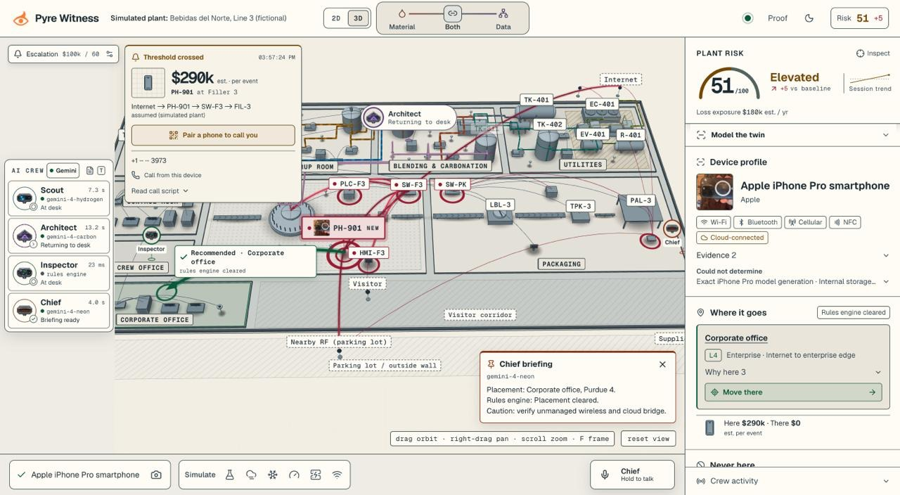
</p>

**Snap any device. See where it belongs in your plant, and what risk it brings, before you plug it in.**

Industrial plants add equipment every week: a new tank, a smart sensor, a contractor's laptop, a Wi-Fi camera, a USB drive. Most of it gets installed first and assessed later, if ever. OT security tools usually find a device only after it is already on the network and talking.

Pyre Witness works one step earlier. An engineer takes 1–3 photos of a device, pastes a product link, or describes it. Gemini 4 identifies it and reasons over a **live digital twin of the plant**, then answers four questions:

1. **Where should it go?** Plant area and Purdue level, and why.
2. **Where must it never go?** And why.
3. **What risk does it bring?** Physical, cyber and compliance, mapped to MITRE ATT&CK for ICS.
4. **Which new attack paths does it open?** For example: *a Wi-Fi radio next to the filler HMI opens a path from the parking lot to the PLC.*

The twin updates live. The device appears on the plant floor and the Purdue map, with any new attack paths and an updated plant risk score. Moving it to the recommended zone reruns the rules check.

> **Demo plant:** *North Beverage Facility, Line 3*, a **fictional** cola bottling line. All plant data is simulated and labelled as such.

> 🚧 **Built during the Gemini 4 NYC Hackathon (Nov 21, 2026).** See [Status](#status).

---

## See it

Light mode is the default. The twin opens in 3D on browsers with WebGL2. Use the top bar's `2D` / `3D` switch to change the view. Its tooltip reads `3D view · heights illustrative`. The lens switches between `Material`, `Both` and `Data`.

| Material: what flows through the pipes | Both: where the two meet | Data: who talks to whom |
| :---: | :---: | :---: |
| 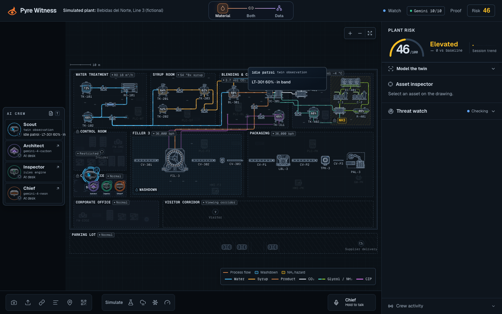 | 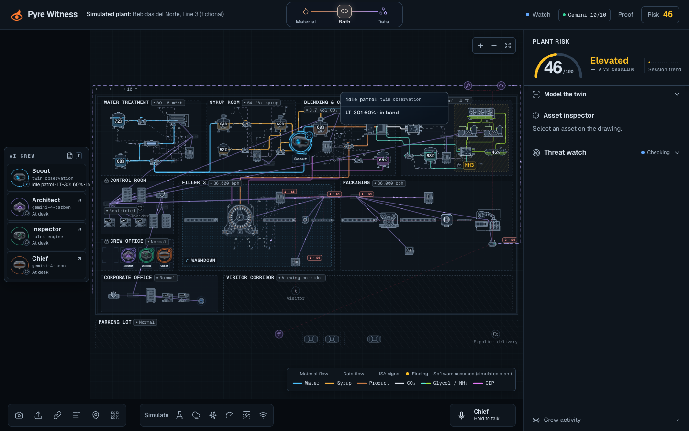 |  |

Screenshots from the running app.

## Feature tour

One real capture, start to finish, on the latest build: real Gemini calls on the simulated plant, captured from the running app on Nov 21, 2026.

| 1 · Capture in progress | 2 · The answer |
| :---: | :---: |
| 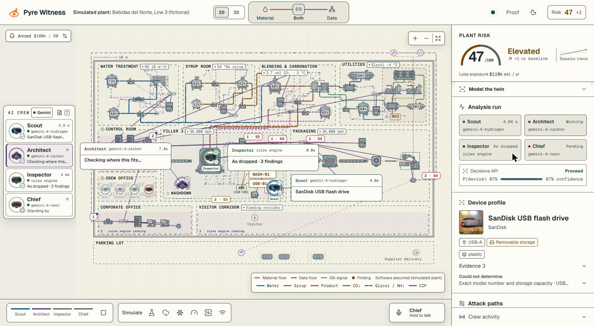 | 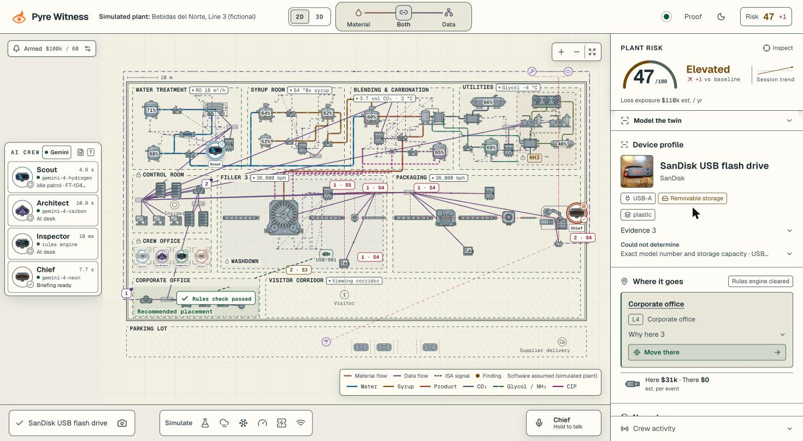 |
| A sample photo of a USB drive, dropped in **Filler 3**. The Decisions API gate says *proceed* (87 %), **Scout** (Hydrogen) names it in 4.9 s, and the **Inspector** (rules engine) flags 3 findings at the drop point while the **Architect** (Carbon) is still reasoning. The crew stands where the work is. | **Where it goes:** corporate office, Purdue L4, *rules check passed*. Removable storage is flagged, attack paths are drawn on the floor, and the loss estimate compares both spots: **here $31k, there $0** per event. |

| 3 · Move there | 4 · Same twin in 3D |
| :---: | :---: |
| 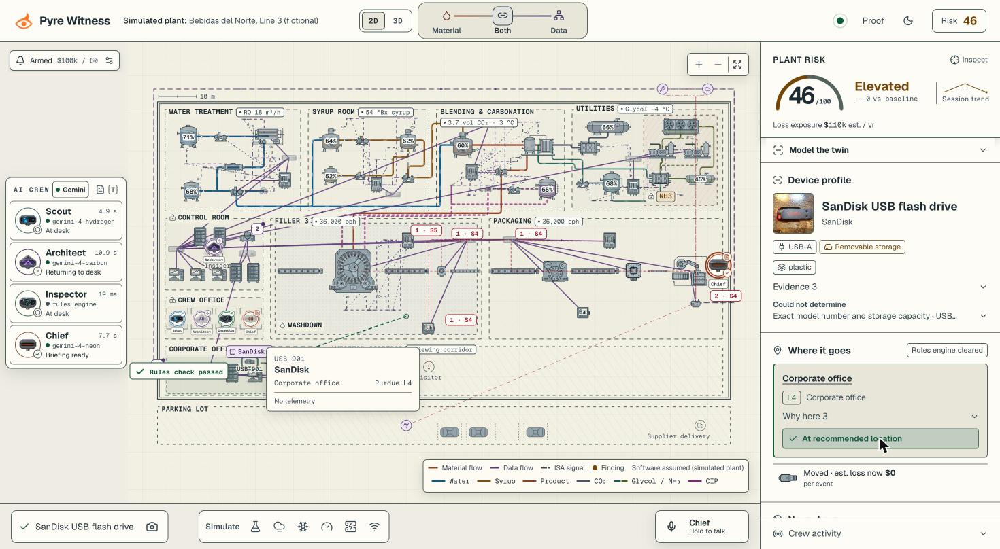 | 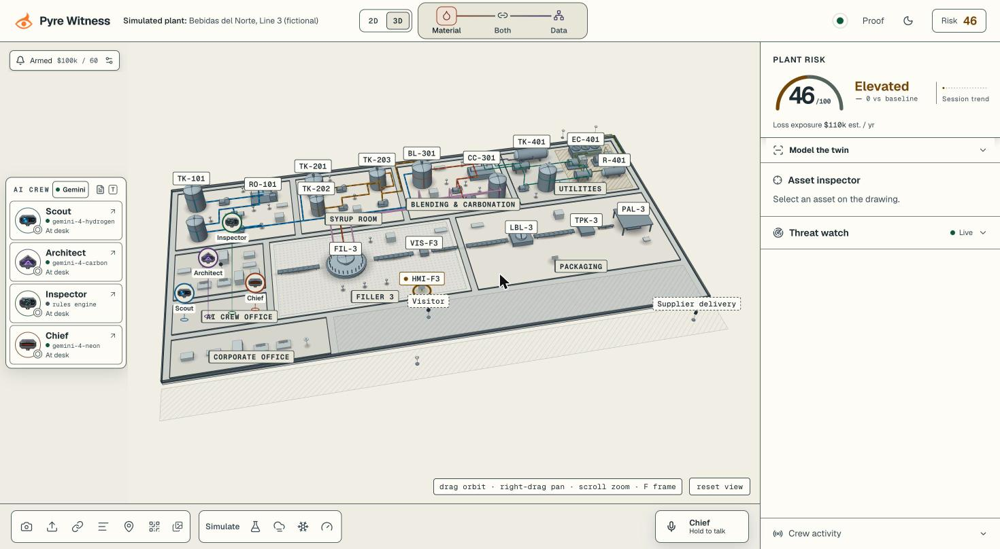 |
| One click: the device moves, the rules engine re-checks, plant risk goes back from **47 to 46** and the estimated loss to **$0**. | The same live twin, selection and attack arcs in 3D, drawn by a hand-written WebGL2 renderer (no 3D library). Heights are illustrative. |

**5 · Proof it works** (`/proof`): Run 5 against the saved single-call baseline, the test set (clean, messy, edge cases, non-devices, links, text), where it still fails, and what changed after each run.

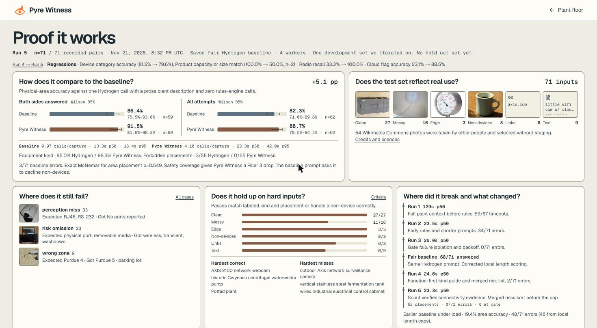

## How it works

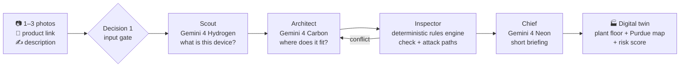

| Step | Who | What happens |
| --- | --- | --- |
| Gate | **Decisions API** (`gemini-decision-1`) | Checks that the input is usable before spending model calls. If the gate is unavailable the run continues and says so. |
| Perceive | **Scout** (`gemini-4-hydrogen`) | Identifies the device and records evidence for radios, cloud connectivity, ports and other features. Reports what remains unknown. |
| Reason | **Architect** (`gemini-4-carbon`, deep reasoning) | Places the device in *this* plant: area, Purdue level, connections. Explains risks and required controls. |
| Verify | **Inspector** (rules engine, **not a model**) | Re-checks the Architect's answer against deterministic plant rules and a graph search for attack paths. If they disagree, the Architect revises once. If no spot is compliant, the answer is **hold**. |
| Brief | **Chief** (`gemini-4-neon`) | Writes the 2–3 line summary for the engineer, and can say it aloud. |

### The crew

<table>
  <tr>
    <td align="center" width="25%"><br><b>Scout</b><br><code>gemini-4-hydrogen</code><br>perception</td>
    <td align="center" width="25%">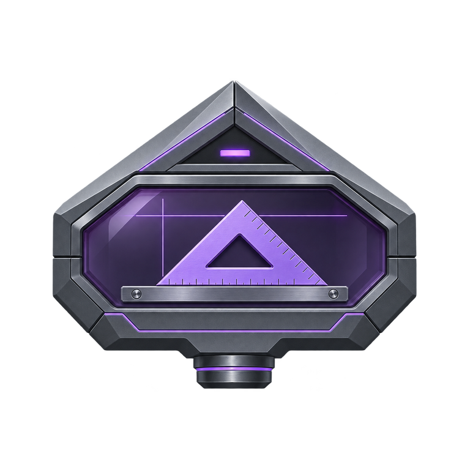<br><b>Architect</b><br><code>gemini-4-carbon</code><br>reasoning</td>
    <td align="center" width="25%">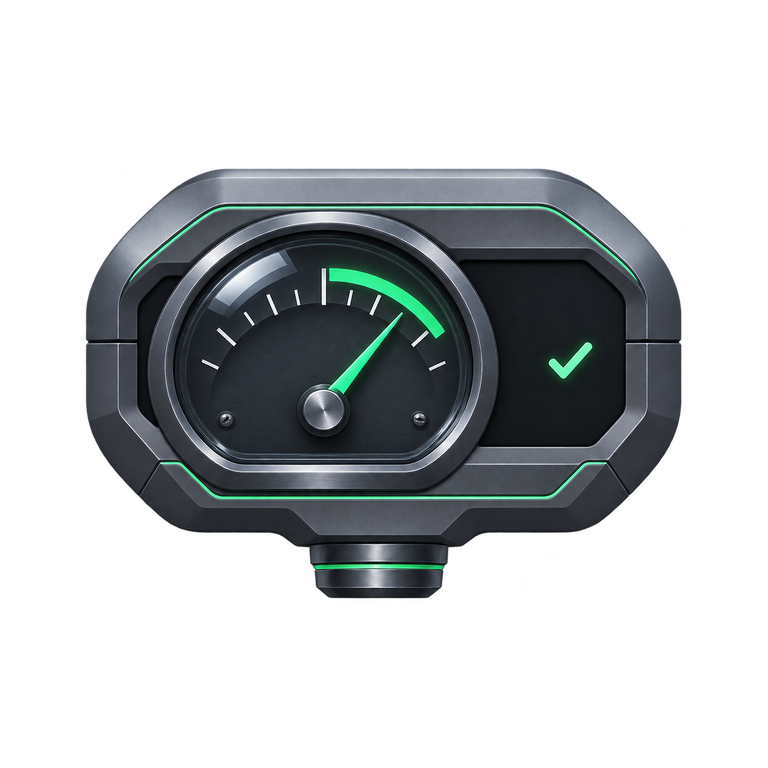<br><b>Inspector</b><br>rules engine<br>not a model</td>
    <td align="center" width="25%">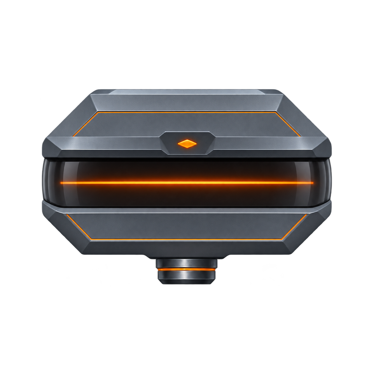<br><b>Chief</b><br><code>gemini-4-neon</code><br>briefing</td>
  </tr>
</table>

Pipeline events drive crew movement and draw the crew's work in 3D, including Scout's evidence, the Inspector's checks, the Architect's placement and the Chief's briefing. Between runs the crew shows `idle patrol`. Press **T** for the transcript, with requests, responses, token counts, timings and JSON or Markdown export.

## The digital twin

Two linked views of the same model. Select an asset in one and it lights up in the other.

- **Plant floor.** The 3D drawing and 2D schematic share the same layout and equipment. The bottling line includes water treatment, syrup, blending and carbonation, filling, packaging, CO₂ and NH₃ utilities, the control room and the corporate office. The twin also marks the parking lot, visitor corridor, NH₃ hazard area and food-grade washdown area. Pipe colours indicate medium.
- **Purdue map.** The same assets by level (L0 process → L1 control → L2 supervisory → L3 site operations → L3.5 IT/OT DMZ → L4/L5 enterprise and cloud), with conduits and firewalls.
- **Lens.** Material ↔ Both ↔ Data (keys `1` `2` `3`). The data side shows the software pipeline, cyber findings and the threat watch; the middle shows both pipelines and the connectors between them.

## What you can do

| | What it does | Gemini service |
| --- | --- | --- |
| **Capture** | Camera, upload, product link, description, or scan a QR code and shoot from your phone | Decisions API, Gemini 4 Hydrogen (vision) |
| **Any object** | A coffee mug is not a cyber risk, but it still has a right and a wrong place in a food plant. Passive objects get physical and food-safety answers only | Gemini 4 Hydrogen, Gemini 4 Carbon |
| **Voice** | The Chief reads the briefing; hold to talk and ask about the plant | `gemini-3.8-flash-tts`, `gemini-3.8-live` |
| **Fit preview** | A picture of the device in place, labelled as an AI-generated visualisation | `gemini-nano-banana-2.1` |
| **Simulation** | Six what-if events (ammonia release, ransomware, carbonation upset, CIP, chiller, wireless). Deterministic, labelled SIMULATION, with mitigations a human approves and a re-run to compare | none (deterministic) |
| **Threat watch** | The small green pulsing status dot in the top bar opens the watch. It matches CISA, NCSC and openFDA items to plant assets and asks a human to approve changes | Decisions API (triage), Gemini 4 Neon, Antigravity managed agent (comparison) |
| **Escalation** | The bell menu has `Add your phone`, `Pair phone` and `Run test alert`. The test adds a labelled `TEST SCENARIO` rogue LTE gateway without a model call. The paired phone can open its dialer with one tap. No carrier integration is needed for that flow | rules engine, optional Gemini TTS for the browser briefing |
| **Twin modeller** | Drop a CSV, photos, a video or a PDF: proposed twin updates to review | Decisions API (input gate), Files API, Gemini 4 Hydrogen, Gemini 4 Neon |
| **Loss estimate** | Every finding, advisory, placement and simulated event carries one number: the estimated dollar loss if it manifests, next to the drawing of the asset. *Show more* itemizes the full calculation asset by asset (FAIR: frequency x magnitude, Monte Carlo, fixed seed) | none (deterministic, assumed plant costs) |
| **Service health** | Model status dots are on the crew cards. `Gemini` in the `AI crew` dock header opens the services board | live probes |

## Rules engine (Inspector)

Deterministic checks the model's answer is verified against:

| Rule | Checks |
| --- | --- |
| `ZONE-01` | Cloud or remote connectivity below the DMZ without documented enforcement |
| `ZONE-02` | Flat or unenforced network links across different trust or consequence zones |
| `ZONE-03` | Declared Purdue level vs. the plant area's placement profile |
| `RF-01` | OT radios within reach of an untrusted location (e.g. parking lot) |
| `USB-01` | Portable media and exposed removable-media interfaces in OT |
| `TRANS-01` | Unmanaged portable endpoints with connectivity at Purdue L0–L2 |
| `CRED-01` | Networked assets with vendor-default credentials |
| `CAM-01` | Cameras that may see operator screens, or leak OT data to the cloud |
| `PHYS-01` | Exposed ports close to visitor-accessible space |
| `HAZ-01`, `HAZ-02` | Ignition-source screening in the NH₃ hazardous area |
| `WASH-01` | Washdown enclosure and hygienic materials near open product |
| `FOOD-02`, `FOOD-03` | Foreign-material and brittle-material control near open product |
| `MGMT-01` | Devices outside plant asset and patch management |
| `SAFE-01` | Reachability of safety-critical targets after path evaluation |
| `PLACE-01` | A device has no compliant home in the plant: hold |

**Plant risk score (0–100).** A transparent index built from rule findings (weighted by severity) and attack-path evidence toward crown-jewel assets (PLCs, safety system). Bands: low < 20, guarded 20–39, elevated 40–59, high 60–79, critical ≥ 80. It is inspired by IEC 62443 zones and conduits and labelled with MITRE ATT&CK for ICS. It is a heuristic for decision support, not a certification.

## How we test it

**Run 5** compares the full pipeline with the same saved fair baseline used in Run 4, one `gemini-4-hydrogen` call with a prose plant description. Both received the same photo bytes, text or product URL. The set has 71 captures (54 Wikimedia Commons photos, 9 descriptions and 8 product links), with 63 devices and 8 non-devices.

Both answered 68 of 71 captures. The table uses shared answers for scores and all 71 attempts for end-to-end timing. Device-type naming uses a separate blinded Decisions API judgment. Significance uses the 5% level.

| Metric | Single-call Hydrogen | Pyre Witness | Paired result |
| --- | ---: | ---: | --- |
| Plant area accuracy | 86.4% (51/59) | 91.5% (54/59) | Inconclusive (`p=0.549`) |
| Equipment kind accuracy | 95.0% (57/60) | 98.3% (59/60) | Inconclusive (`p=0.625`) |
| Purdue level accuracy | 94.5% (52/55) | 94.5% (52/55) | Tie |
| Device vs non-device accuracy | 100.0% (68/68) | 100.0% (68/68) | Tie |
| Key-risk recall | 51.7% (62/120) | 70.0% (84/120) | Significant gain of 18.3 pp (95% paired bootstrap interval +9.3 to +26.9 pp, 56 pairs) |
| Forbidden-area recommendations | 5.5% (3/55) | 0.0% (0/55) | Inconclusive (`p=0.250`) |
| Radio recall | 100.0% (12/12) | 100.0% (12/12) | Tie |
| Cloud flag accuracy | 88.5% (23/26) | 88.5% (23/26) | Tie |
| Device category accuracy | 87.3% (48/55) | 80.0% (44/55) | Hydrogen leads, inconclusive |
| Device-type naming match | 67.3% (37/55) | 78.2% (43/55) | Inconclusive |
| Median time per capture | 13.3 s | 23.3 s | Significantly slower |
| p95 time per capture | 18.4 s | 42.0 s | Significantly slower |

These results use one development set that informed the changes. The held-out test below uses captures that no change was tuned on. [Summary](eval/report/SUMMARY.md) · [Full report](eval/report/REPORT.md)

- Run 3 trailed Hydrogen on equipment kind and key-risk recall. Run 4 fixed those gaps with kind guidance and a risk list that combines model risks, rules findings and Scout evidence.
- Run 4 trailed on radio recall (33.3%) and cloud flags (23.1%). Asking Scout for explicit connectivity evidence brought Run 5 up to Hydrogen's rates on both.

### Held-out test

After the last pipeline change we built 20 new captures: 13 Wikimedia Commons photos (4 clean, 5 messy, 2 edge, 2 non-devices), 3 hurried free-text descriptions and 4 manufacturer product links. None overlaps the development set. They were labelled from source evidence before any system saw them, and no change was made after the run. Both sides ran fresh once (`heldout-1`) with 0 errors, the same baseline contract and Run 5 scoring.

| Metric | Single-call Hydrogen | Pyre Witness | Paired result |
| --- | ---: | ---: | --- |
| Key-risk recall | 40.8% (20/49) | 61.2% (30/49) | Significant gain of 20.4 pp (+8.3 to +34.0 pp) |
| Device-type naming match | 57.1% (8/14) | 92.9% (13/14) | Significant gain of 35.7 pp (+14.3 to +64.3 pp) |
| Offline rules-engine pass rate | 83.3% (15/18) | 100.0% (20/20) | Inconclusive |
| Forbidden-area recommendations | 0.0% (0/14) | 0.0% (0/14) | Tie |
| Device vs non-device accuracy | 100.0% (20/20) | 100.0% (20/20) | Tie |
| Plant area accuracy | 88.9% (16/18) | 83.3% (15/18) | Hydrogen leads, inconclusive |
| Purdue level accuracy | 85.7% (12/14) | 78.6% (11/14) | Hydrogen leads, inconclusive |
| Equipment kind accuracy | 72.2% (13/18) | 77.8% (14/18) | Inconclusive |
| Cloud flag accuracy | 92.3% (12/13) | 76.9% (10/13) | Hydrogen leads, inconclusive |
| Median time per capture | 12.1 s | 26.0 s | Significantly slower |

The key-risk recall gain held on unseen captures. Placement accuracy did not beat the single call. Before the run, a label review changed two labels to match development-set conventions, and the drone change decided that item. Under the original labels, Hydrogen passes 14 of 20 cases and Pyre Witness 12, instead of 13 each. Risk recall, naming and the rules check do not depend on those labels. With n = 20, most differences are inconclusive. [Held-out report](eval/heldout/REPORT.md) · [Held-out log](docs/log/heldout-eval.md)

Open `Proof` (`/proof`) for the runs, failure cases and changes after each run. Run 5 recorded zero system execution errors. [Summary](eval/report/SUMMARY.md)

In the separate six-worker reliability batch, 61 of 63 captures completed and two were correctly rejected. The median was 28.905 s with zero execution failures. [Reliability log](docs/log/pipeline-speed.md)

## Run it locally

Requirements: Node.js 20+ and a Gemini API key.

```bash
git clone https://github.com/FodelaO/Pyre-Witness.git
cd Pyre-Witness
npm install
cp .env.example .env     # then add your GEMINI_API_KEY
npm run dev              # http://localhost:4119
```

| URL | What |
| --- | --- |
| `/` | The twin: plant floor, lens, capture, crew, simulation, threat watch |
| `/proof` | Evaluation results against the single-call baseline |
| `/gallery` | Every equipment symbol |

Other scripts: `npm run test` (vitest), `npm run typecheck`, `npm run eval`.

The API key is used **server-side only**. It is never sent to the browser, logged or committed (`.env*` is git-ignored).

## Tech

Next.js 16 (App Router) · React 19 · TypeScript · Tailwind CSS 4 · zustand · motion · `@google/genai` · zod · vitest · Playwright.

```
src/
  twin/        plant model, seed data (Line 3), geometry, store
  equipment/   parametric SVG equipment library
  floor/       plant floor view, pipes, zones, attack paths
  purdue/      Purdue network map
  layers/      material / both / data lens
  rules/       deterministic rules engine, attack-path graph, risk score
  crew/        AI crew avatars, dock and activity feed
  transcript/  full run transcript and export
  capture/     photo / link / description capture, phone handoff
  pipeline/    pipeline contracts, events and server
  gemini/      model IDs, roles and API calls (server only)
  sim/         deterministic what-if simulation and mitigations
  watch/       daily threat watch
  voice/       briefing speech and live voice
  fit/         fit preview image
  modeler/     twin modeller (CSV, photos, video, PDF)
  health/      live checks of every Google service used
  econ/        estimated economic loss per detection (FAIR, deterministic)
  data/        MITRE ATT&CK for ICS reference, compliance catalogue
eval/          evaluation harness, dataset, runs
docs/          architecture, build log per feature
```

More detail: [`docs/OVERVIEW.md`](docs/OVERVIEW.md) · [`docs/ARCHITECTURE.md`](docs/ARCHITECTURE.md) · [`docs/BUILD_LOG.md`](docs/BUILD_LOG.md).

## Status

Built from scratch during the hackathon. The commit history shows the timeline.

- ✅ Twin data model and Line 3 seed (92 assets, 13 areas, 6 entry points), with geometry tests
- ✅ Parametric SVG equipment library (process, control/network, wireless and portable devices)
- ✅ Deterministic rules engine, attack-path graph and risk score, with tests
- ✅ Interactive plant floor, Purdue map and the material / both / data lens
- ✅ Capture flow (photo, link, description, phone handoff) and the Gemini pipeline
- ✅ AI crew driven by real pipeline events, crew dock and full transcript
- ✅ Simulation with mitigations and human approval
- ✅ Daily threat watch with human approval
- ✅ Voice, fit preview, twin modeller, live service health
- ✅ Evaluation harness against a single-call baseline (`/proof`)
- ✅ Estimated economic loss per finding, advisory, placement and simulation (deterministic, assumed plant costs)
- ✅ Light theme and 3D by default, with 2D and dark mode available
- ✅ Paired-phone escalation and labelled test alert

## What is real and what is simulated

- **Real:** every model call (no mocked responses), the rules engine, the attack-path search, the evaluation runs, the advisories read by the threat watch.
- **Simulated and labelled:** the plant itself, its inventory and telemetry, and the what-if events.

## Team

Built at the Gemini 4 NYC Hackathon by **Pablo Zavala** and **Rodolfo de la O Jr** ([@FodelaO](https://github.com/FodelaO)).
