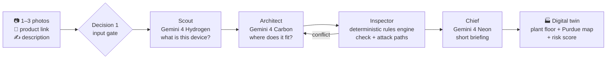

# 🔥👁️ Pyre Witness

**Snap any device. See where it belongs in your plant, and what risk it brings, before you plug it in.**

Industrial plants add equipment every week: a new tank, a smart sensor, a contractor's laptop, a Wi-Fi camera, a USB drive. Most of it gets installed first and assessed later, if ever. OT security tools usually find a device only after it is already on the network and talking.

Pyre Witness works one step earlier. An engineer takes 1–3 photos of a device, pastes a product link, or describes it. Gemini 4 identifies it and reasons over a **live digital twin of the plant**, then answers four questions:

1. **Where should it go?** Plant area and Purdue level, and why.
2. **Where must it never go?** And why.
3. **What risk does it bring?** Physical, cyber and compliance, mapped to MITRE ATT&CK for ICS.
4. **Which new attack paths does it open?** For example: *a Wi-Fi radio next to the filler HMI opens a path from the parking lot to the PLC.*

The twin updates live. The device appears on the plant floor and on the Purdue map, new attack paths are drawn, and the plant risk score changes. Move it to the recommended zone and the risk drops.

> **Demo plant:** *Bebidas del Norte, Line 3*, a **fictional** cola bottling line. All plant data is simulated and labelled as such.

> 🚧 **Built during the Gemini 4 NYC Hackathon (Nov 21, 2026).** Work in progress. See [Status](#status).

---

## How it works



| Step | Who | What happens |
| --- | --- | --- |
| Gate | **Decisions API** (`gemini-decision-1`) | Checks that the input is usable before spending model calls. |
| Perceive | **Scout** (`gemini-4-hydrogen`, fast) | Reads the photos: device type, brand/model from labels, radios, ports, storage, camera/mic, default-password stickers. Asks for another photo if something key is not visible. |
| Reason | **Architect** (`gemini-4-carbon`, deep reasoning) | Places the device in *this* plant: area, Purdue level, connections. Explains risks and required controls. |
| Verify | **Inspector** (rules engine, **not a model**) | Re-checks the Architect's answer against deterministic plant rules and a graph search for attack paths. If they disagree, the Architect revises once. |
| Brief | **Chief** (`gemini-4-neon`) | Writes the 2–3 line summary for the engineer. |

The crew walks the plant floor as these steps actually run. Their movement and the activity feed are driven by real pipeline events, never by timers. When nothing is happening they do an **idle patrol** that is labelled as such and never shows findings.

## The digital twin

Two linked views of the same model. Select an asset in one and it lights up in the other.

- **Plant floor.** Top-down schematic of the bottling line with real equipment shapes (hand-drawn parametric SVG): water treatment, syrup room, blending & carbonation, filler, packaging, CO₂ and NH₃ utilities, control room, corporate office. It also models the context around the plant: parking lot, visitor corridor, hazardous NH₃ area, food-grade washdown area. Pipes are colour-coded by medium (water, syrup, product, CO₂, glycol/NH₃, CIP caustic, network).
- **Purdue map.** The same assets by level (L0 process → L1 control → L2 supervisory → L3 site operations → L3.5 IT/OT DMZ → L4/L5 enterprise and cloud), with conduits and firewalls.

## Rules engine (Inspector)

Deterministic checks the model's answer is verified against:

| Rule | Checks |
| --- | --- |
| `ZONE-01` | Cloud or remote connectivity below the DMZ without documented enforcement |
| `ZONE-02` | Flat or unenforced network links across different trust or consequence zones |
| `ZONE-03` | Declared Purdue level vs. the plant area's placement profile |
| `RF-01` | OT radios within reach of an untrusted location (e.g. parking lot) |
| `USB-01` | Portable media and exposed removable-media interfaces in OT |
| `TRANS-01` | Unmanaged portable endpoints with connectivity at Purdue L0–L2 |
| `CRED-01` | Networked assets with vendor-default credentials |
| `CAM-01` | Cameras that may see operator screens, or leak OT data to the cloud |
| `PHYS-01` | Exposed ports close to visitor-accessible space |
| `HAZ-01` | Ignition-source screening in the NH₃ hazardous area |
| `WASH-01` | Washdown enclosure and hygienic materials near open product |
| `MGMT-01` | Devices outside plant asset and patch management |
| `SAFE-01` | Reachability of safety-critical targets after path evaluation |

**Plant risk score (0–100).** A transparent index built from rule findings (weighted by severity) and attack-path evidence toward crown-jewel assets (PLCs, safety system). Bands: low < 20, guarded 20–39, elevated 40–59, high 60–79, critical ≥ 80. It is inspired by IEC 62443 zones and conduits and labelled with MITRE ATT&CK for ICS. It is a heuristic for decision support, not a certification.

## How we test it

The hackathon asks for proof beyond the demo. Our evaluation harness (`npm run eval`) compares:

- **Baseline:** one single Gemini call with the photo: *"Where should this device go in an industrial plant and what risks does it bring?"* No twin, no rules.
- **Pyre Witness:** perception, then reasoning over the twin, then the rules check.

Metrics: device identification, correct Purdue level, correct plant area, key risks found (radio, removable media, default credentials, cloud, personal device), unsafe recommendations, and how often the rules engine forced a revision. The test images come from other attendees' devices and openly licensed photos, never from images we staged to pass. Failures are reported, not hidden.

## Run it locally

Requirements: Node.js 20+ and a Gemini API key.

```bash
git clone https://github.com/FodelaO/Pyre-Witness.git
cd Pyre-Witness
npm install
cp .env.example .env     # then add your GEMINI_API_KEY
npm run dev              # http://localhost:4119
```

Other scripts: `npm run test` (vitest), `npm run typecheck`, `npm run eval`.

The API key is used **server-side only**. It is never sent to the browser, logged or committed (`.env*` is git-ignored).

## Tech

Next.js 16 (App Router) · React 19 · TypeScript · Tailwind CSS 4 · zustand · motion · `@google/genai` · zod · vitest · Playwright.

```
src/
  twin/        plant model, seed data (Line 3), geometry, store
  equipment/   parametric SVG equipment library
  floor/       plant floor view, pipes, zones, attack paths
  purdue/      Purdue network map
  rules/       deterministic rules engine, attack-path graph, risk score
  crew/        AI crew avatars + activity feed
  capture/     photo / link / description capture
  pipeline/    shared pipeline contracts and events
  gemini/      model IDs and roles
  data/        MITRE ATT&CK for ICS reference
docs/log/      build log per feature
```

## Status

Built from scratch during the hackathon. The commit history shows the timeline.

- ✅ Twin data model and Line 3 seed, with geometry tests
- ✅ Parametric SVG equipment library (process, control/network, wireless and portable devices)
- ✅ Deterministic rules engine, attack-path graph and risk score, with tests
- ✅ Interactive plant floor and device placement
- 🚧 Capture flow, Gemini pipeline API, crew events, Purdue map, simulations, evaluation harness

## Team

Built at the Gemini 4 NYC Hackathon by **Pablo Zavala** and **Rodolfo de la O Jr** ([@FodelaO](https://github.com/FodelaO)).
