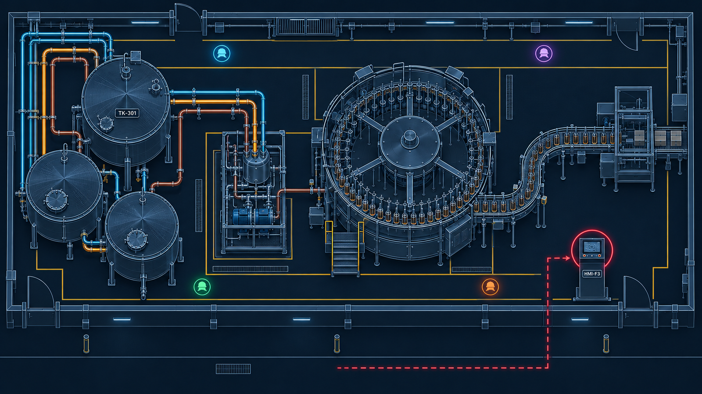
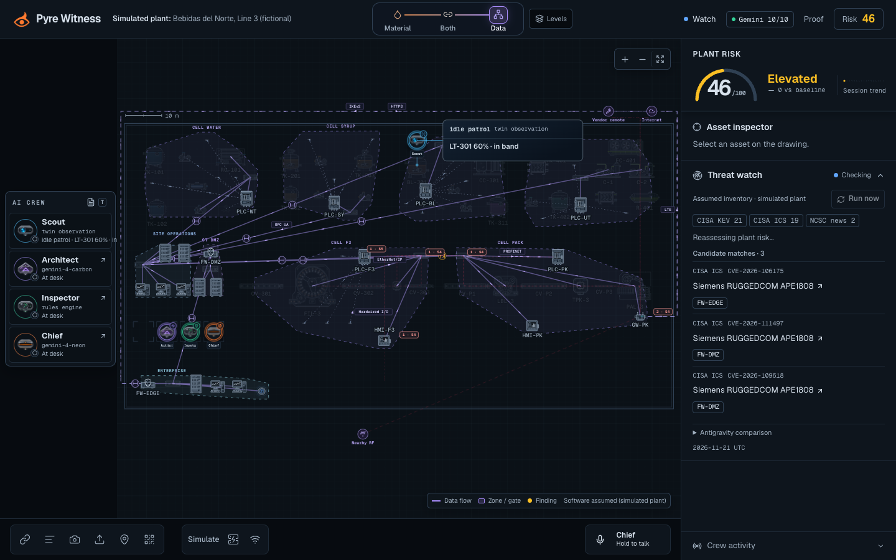
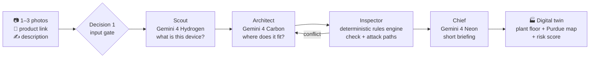
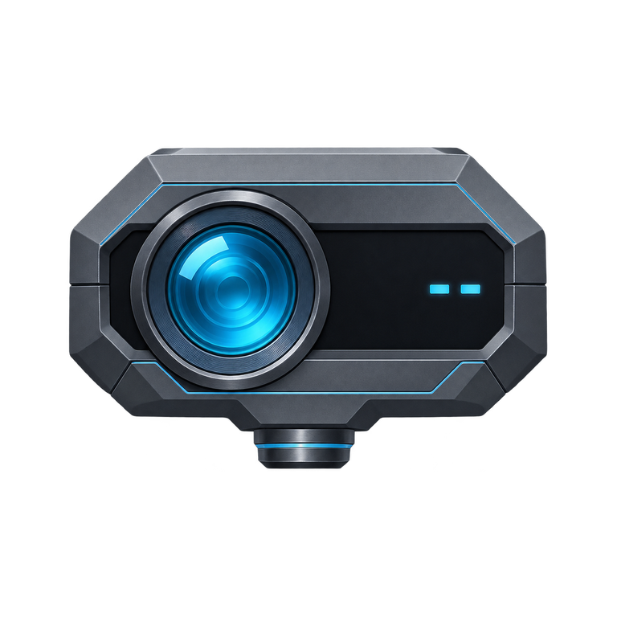

# 🔥👁️ Pyre Witness

<p align="center">
  
</p>

**Snap any device. See where it belongs in your plant, and what risk it brings, before you plug it in.**

Industrial plants add equipment every week: a new tank, a smart sensor, a contractor's laptop, a Wi-Fi camera, a USB drive. Most of it gets installed first and assessed later, if ever. OT security tools usually find a device only after it is already on the network and talking.

Pyre Witness works one step earlier. An engineer takes 1–3 photos of a device, pastes a product link, or describes it. Gemini 4 identifies it and reasons over a **live digital twin of the plant**, then answers four questions:

1. **Where should it go?** Plant area and Purdue level, and why.
2. **Where must it never go?** And why.
3. **What risk does it bring?** Physical, cyber and compliance, mapped to MITRE ATT&CK for ICS.
4. **Which new attack paths does it open?** For example: *a Wi-Fi radio next to the filler HMI opens a path from the parking lot to the PLC.*

The twin updates live. The device appears on the plant floor and on the Purdue map, new attack paths are drawn, and the plant risk score changes. Move it to the recommended zone and the risk drops.

> **Demo plant:** *Bebidas del Norte, Line 3*, a **fictional** cola bottling line. All plant data is simulated and labelled as such.

> 🚧 **Built during the Gemini 4 NYC Hackathon (Nov 21, 2026).** See [Status](#status).

---

## See it

One screen. A three-way lens switches between the material pipeline, the data / software pipeline, and both with the connectors between them.

| Material: what flows through the pipes | Both: where the two meet | Data: who talks to whom |
| :---: | :---: | :---: |
|  |  |  |

Screenshots of the running app (`npm run dev`), not mock-ups.

## How it works



| Step | Who | What happens |
| --- | --- | --- |
| Gate | **Decisions API** (`gemini-decision-1`) | Checks that the input is usable before spending model calls. If the gate is unavailable the run continues and says so. |
| Perceive | **Scout** (`gemini-4-hydrogen`, fast) | Reads the photos: device type, brand/model from labels, radios, ports, storage, camera/mic, default-password stickers. Says what it could not see. |
| Reason | **Architect** (`gemini-4-carbon`, deep reasoning) | Places the device in *this* plant: area, Purdue level, connections. Explains risks and required controls. |
| Verify | **Inspector** (rules engine, **not a model**) | Re-checks the Architect's answer against deterministic plant rules and a graph search for attack paths. If they disagree, the Architect revises once. If no spot is compliant, the answer is **hold**. |
| Brief | **Chief** (`gemini-4-neon`) | Writes the 2–3 line summary for the engineer, and can say it aloud. |

### The crew

<table>
  <tr>
    <td align="center" width="25%"><br><b>Scout</b><br><code>gemini-4-hydrogen</code><br>perception</td>
    <td align="center" width="25%"><br><b>Architect</b><br><code>gemini-4-carbon</code><br>reasoning</td>
    <td align="center" width="25%"><br><b>Inspector</b><br>rules engine<br>not a model</td>
    <td align="center" width="25%"><br><b>Chief</b><br><code>gemini-4-neon</code><br>briefing</td>
  </tr>
</table>

The crew walks the plant floor as these steps actually run. Their movement and the activity feed are driven by real pipeline events, never by timers. When nothing is happening they do an **idle patrol** that is labelled as such and never shows findings. Press **T** for the full transcript of every run: each request, each raw response, token counts and timings, with JSON and Markdown export.

## The digital twin

Two linked views of the same model. Select an asset in one and it lights up in the other.

- **Plant floor.** Top-down schematic of the bottling line with real equipment shapes (hand-drawn parametric SVG): water treatment, syrup room, blending & carbonation, filler, packaging, CO₂ and NH₃ utilities, control room, corporate office. It also models the context around the plant: parking lot, visitor corridor, hazardous NH₃ area, food-grade washdown area. Pipes are colour-coded by medium (water, syrup, product, CO₂, glycol/NH₃, CIP caustic, network).
- **Purdue map.** The same assets by level (L0 process → L1 control → L2 supervisory → L3 site operations → L3.5 IT/OT DMZ → L4/L5 enterprise and cloud), with conduits and firewalls.
- **Lens.** Material ↔ Both ↔ Data (keys `1` `2` `3`). The data side shows the software pipeline, cyber findings and the threat watch; the middle shows both pipelines and the connectors between them.

## More than a text box

| | What it does | Gemini service |
| --- | --- | --- |
| **Capture** | Camera, upload, product link, description, or scan a QR code and shoot from your phone | Decisions API, Gemini 4 Hydrogen (vision) |
| **Any object** | A coffee mug is not a cyber risk, but it still has a right and a wrong place in a food plant. Passive objects get physical and food-safety answers only | Gemini 4 Hydrogen, Gemini 4 Carbon |
| **Voice** | The Chief reads the briefing; hold to talk and ask about the plant | `gemini-3.8-flash-tts`, `gemini-3.8-live` |
| **Fit preview** | A picture of the device in place, labelled as an AI-generated visualisation | `gemini-nano-banana-2.1` |
| **Simulation** | Six what-if events (ammonia release, ransomware, carbonation upset, CIP, chiller, wireless). Deterministic, labelled SIMULATION, with mitigations a human approves and a re-run to compare | none (deterministic) |
| **Threat watch** | Reads CISA KEV, CISA ICS advisories and NCSC news, matches them to the plant's inventory, proposes changes, waits for approval | Decisions API (triage), Gemini 4 Neon, Antigravity managed agent (comparison) |
| **Twin modeller** | Drop a CSV, photos, a video or a PDF: proposed twin updates to review | Decisions API (input gate), Files API, Gemini 4 Hydrogen, Gemini 4 Neon |
| **Loss estimate** | Every finding, advisory, placement and simulated event carries one number: the estimated dollar loss if it manifests, next to the drawing of the asset. *Show more* itemizes the full calculation asset by asset (FAIR: frequency x magnitude, Monte Carlo, fixed seed) | none (deterministic, assumed plant costs) |
| **Service health** | The top bar shows every Google service the app depends on, probed live | all of the above |

## Rules engine (Inspector)

Deterministic checks the model's answer is verified against:

| Rule | Checks |
| --- | --- |
| `ZONE-01` | Cloud or remote connectivity below the DMZ without documented enforcement |
| `ZONE-02` | Flat or unenforced network links across different trust or consequence zones |
| `ZONE-03` | Declared Purdue level vs. the plant area's placement profile |
| `RF-01` | OT radios within reach of an untrusted location (e.g. parking lot) |
| `USB-01` | Portable media and exposed removable-media interfaces in OT |
| `TRANS-01` | Unmanaged portable endpoints with connectivity at Purdue L0–L2 |
| `CRED-01` | Networked assets with vendor-default credentials |
| `CAM-01` | Cameras that may see operator screens, or leak OT data to the cloud |
| `PHYS-01` | Exposed ports close to visitor-accessible space |
| `HAZ-01`, `HAZ-02` | Ignition-source screening in the NH₃ hazardous area |
| `WASH-01` | Washdown enclosure and hygienic materials near open product |
| `FOOD-02`, `FOOD-03` | Foreign-material and brittle-material control near open product |
| `MGMT-01` | Devices outside plant asset and patch management |
| `SAFE-01` | Reachability of safety-critical targets after path evaluation |
| `PLACE-01` | A device has no compliant home in the plant: hold |

**Plant risk score (0–100).** A transparent index built from rule findings (weighted by severity) and attack-path evidence toward crown-jewel assets (PLCs, safety system). Bands: low < 20, guarded 20–39, elevated 40–59, high 60–79, critical ≥ 80. It is inspired by IEC 62443 zones and conduits and labelled with MITRE ATT&CK for ICS. It is a heuristic for decision support, not a certification.

## How we test it

The hackathon asks for proof beyond the demo. Our evaluation harness (`npm run eval`) compares:

- **Baseline:** one single Gemini call with the photo: *"Where should this device go in an industrial plant and what risks does it bring?"* No twin, no rules.
- **Pyre Witness:** perception, then reasoning over the twin, then the rules check.

Metrics: device identification, correct Purdue level, correct plant area, key risks found (radio, removable media, default credentials, cloud, personal device), unsafe recommendations, and how often the rules engine forced a revision. The test images are openly licensed photos that we did not take, never images we staged to pass. Failures are reported, not hidden.

- **Dataset:** 71 labelled captures: 54 openly licensed photos from Wikimedia Commons (taken by other people, before this project), 9 written descriptions and 8 live product links; 55 devices and 8 non-devices; 30 clean, 20 messy, 13 edge cases. Labels and licences are in `eval/dataset/`.
- **How it is scored:** both systems get the same input (image bytes or text only, never the file name or the label). A deterministic scorer compares each answer with the labels; device-type naming is judged by a separate, blinded Decisions API call. Results are paired on the captures both systems answered, with Wilson 95% intervals and exact McNemar tests.
- **Latest result (run 4 against a fair re-run of the baseline, 66 of 71 answered by both):**

| Metric | Single call | Pyre Witness |
| --- | --- | --- |
| Recommended a forbidden area | 5.6% (3/54) | **0.0% (0/54)** |
| Key risks found | 51.7% (61/118) | **58.5% (69/118)** |
| Equipment kind correct | 94.8% (55/58) | **98.3% (57/58)** |
| Plant area correct | 87.7% | 89.5% (n=57, not significant) |
| Purdue level correct | 96.3% | 94.4% |
| Device vs non-device | 100% | 100% |
| Radio recall | **100% (12/12)** | 33.3% (4/12) |
| Cloud flag correct | **88.5% (23/26)** | 23.1% (6/26) |
| Device category correct | **87.0%** | 81.5% (n=54) |
| Device type named correctly | **66.7%** | 61.1% (n=54) |
| Median time per capture | **13.3 s** | 24.6 s |

- **What that means:** a single Gemini 4 call is a strong baseline. The pipeline never recommended a forbidden area, finds more of the labelled risks overall, and matches it on equipment kind and plant area. The single call is clearly better at listing radios and flagging cloud connectivity in the device profile, and slightly better at naming the device; that is our next fix. What the pipeline adds that one call cannot: a deterministic check of every answer, attack paths in this plant, a risk score, a dollar estimate and a live twin. Apart from radios and cloud flags, no difference is statistically significant on 71 items, and it is one development set that we iterated on (no held-out set yet).
- **Where to look:** open **`/proof`** in the running app: every run, the baseline next to the system, the failures with their images, and what we changed after seeing them. Full report in `eval/report/`.
- **Reliability:** on 63 captures at six in parallel, 61 completed, 2 were correctly rejected (a defocused photo and a landscape), and none failed operationally (median 29 s).

## Run it locally

Requirements: Node.js 20+ and a Gemini API key.

```bash
git clone https://github.com/FodelaO/Pyre-Witness.git
cd Pyre-Witness
npm install
cp .env.example .env     # then add your GEMINI_API_KEY
npm run dev              # http://localhost:4119
```

| URL | What |
| --- | --- |
| `/` | The twin: plant floor, lens, capture, crew, simulation, threat watch |
| `/proof` | Evaluation results against the single-call baseline |
| `/gallery` | Every equipment symbol |

Other scripts: `npm run test` (vitest), `npm run typecheck`, `npm run eval`.

The API key is used **server-side only**. It is never sent to the browser, logged or committed (`.env*` is git-ignored).

## Tech

Next.js 16 (App Router) · React 19 · TypeScript · Tailwind CSS 4 · zustand · motion · `@google/genai` · zod · vitest · Playwright.

```
src/
  twin/        plant model, seed data (Line 3), geometry, store
  equipment/   parametric SVG equipment library
  floor/       plant floor view, pipes, zones, attack paths
  purdue/      Purdue network map
  layers/      material / both / data lens
  rules/       deterministic rules engine, attack-path graph, risk score
  crew/        AI crew avatars, dock and activity feed
  transcript/  full run transcript and export
  capture/     photo / link / description capture, phone handoff
  pipeline/    pipeline contracts, events and server
  gemini/      model IDs, roles and API calls (server only)
  sim/         deterministic what-if simulation and mitigations
  watch/       daily threat watch
  voice/       briefing speech and live voice
  fit/         fit preview image
  modeler/     twin modeller (CSV, photos, video, PDF)
  health/      live checks of every Google service used
  econ/        estimated economic loss per detection (FAIR, deterministic)
  data/        MITRE ATT&CK for ICS reference, compliance catalogue
eval/          evaluation harness, dataset, runs
docs/          architecture, build log per feature
```

More detail: [`docs/OVERVIEW.md`](docs/OVERVIEW.md) · [`docs/ARCHITECTURE.md`](docs/ARCHITECTURE.md) · [`docs/BUILD_LOG.md`](docs/BUILD_LOG.md).

## Status

Built from scratch during the hackathon. The commit history shows the timeline.

- ✅ Twin data model and Line 3 seed (92 assets, 13 areas, 6 entry points), with geometry tests
- ✅ Parametric SVG equipment library (process, control/network, wireless and portable devices)
- ✅ Deterministic rules engine, attack-path graph and risk score, with tests
- ✅ Interactive plant floor, Purdue map and the material / both / data lens
- ✅ Capture flow (photo, link, description, phone handoff) and the Gemini pipeline
- ✅ AI crew driven by real pipeline events, crew dock and full transcript
- ✅ Simulation with mitigations and human approval
- ✅ Daily threat watch with human approval
- ✅ Voice, fit preview, twin modeller, live service health
- ✅ Evaluation harness against a single-call baseline (`/proof`)
- ✅ Estimated economic loss per finding, advisory, placement and simulation (deterministic, assumed plant costs)
- 🚧 Optional 3D view; one-minute demo video

## What is real and what is simulated

- **Real:** every model call (no mocked responses), the rules engine, the attack-path search, the evaluation runs, the advisories read by the threat watch.
- **Simulated and labelled:** the plant itself, its inventory and telemetry, and the what-if events.

## Team

Built at the Gemini 4 NYC Hackathon by **Pablo Zavala** and **Rodolfo de la O Jr** ([@FodelaO](https://github.com/FodelaO)).
