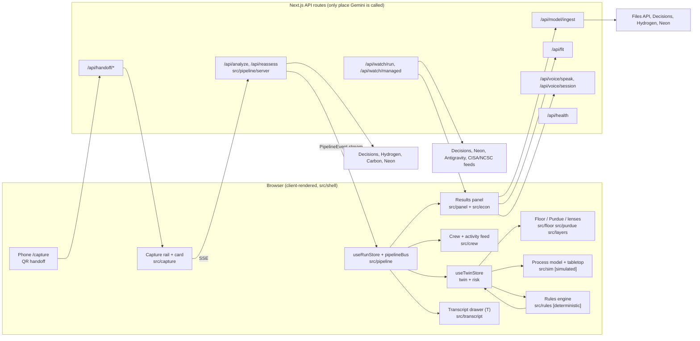

# Pyre Witness: architecture

How the code is built, as of 13:40 EST on Nov 21, 2026. Read from the code; numbers cite a file or log.

Legend: **[model]** = a Gemini call. **[deterministic]** = plain TypeScript, same input gives same output. **[simulated]** = fictional plant data or a what-if replay, labelled in the UI.

## System diagram

## Folders

| Path | What it does | Kind |
| --- | --- | --- |
| `src/twin` | Types, zustand store (re-runs rules on every change), geometry, `applyEffects`, seed plant | deterministic; plant simulated |
| `src/equipment` | `29` parametric SVG equipment kinds, `/gallery` | drawing |
| `src/floor` | 1600 × 1000 floor, pipes, attack paths, drag to reassess | UI |
| `src/purdue` | Purdue L0 to L5 + L3.5 DMZ map, conduits | UI |
| `src/layers` | Material / Both / Data lens, data-flow drawing, Purdue Levels view | UI |
| `src/rules` | Rules engine, attack-path search, risk score, placement ranking | deterministic |
| `src/data` | ATT&CK for ICS v20.1 (`104` techniques), compliance catalogue (`58` clauses) | reference data |
| `src/gemini` | Transport (`v1beta`, retries), schemas, gate, perception, assessment, briefing | model calls |
| `src/pipeline` | Event contracts, run store, SSE client, server orchestration, self-check | orchestration |
| `src/link` | SSRF-guarded product page fetch and extraction | deterministic |
| `src/capture`, `src/handoff` | Camera, upload, link, text, pin; same-LAN phone QR handoff | UI |
| `src/crew` | Four crew members driven by pipeline events; `idle patrol` between runs | UI |
| `src/panel` | Results panel, placement answer, mitigation queue, asset inspector | UI |
| `src/transcript` | Prompts, raw responses, tokens, timing; JSON / Markdown export | UI |
| `src/sim` | Process model, `6` tabletop scenarios, counterfactuals | simulated, deterministic |
| `src/watch` | Feeds, inventory match, Decisions triage, Neon reassessment, Antigravity run | model + deterministic |
| `src/modeler` | Files to proposed ghost assets, human apply | model |
| `src/fit` | Fit preview images | model (image) |
| `src/voice` | TTS briefing; push-to-talk Live voice with `5` tools | model (audio) |
| `src/health` | `10` service probes, `Gemini n/10` chip | live probes |
| `src/econ` | Economic loss model and loss figures | deterministic, assumed costs |
| `src/view3d` | Optional 3D view of the same twin; hand-written WebGL2, no 3D library; `2D` / `3D` switch | deterministic drawing |
| `src/escalation` | Threshold policy, alert card, phone pairing over LAN streams, call script, phone approve / acknowledge | deterministic + TTS |
| `src/theme` | Dark / light theme switch | UI |
| `src/proof` | `/proof` evaluation report | reads `eval/report` |
| `eval/` | Paired evaluation harness, `71`-item dataset | model + scoring |
| `scripts/` | `smoke-pipeline`, `bench-pipeline`, `daily-watch`, `health`, `smoke-modeler` | CLI |

Pages: `/`, `/gallery`, `/proof`, `/lens`, `/crew-review`, `/capture` (phone), `/3d` (3D review).
API routes: `analyze`, `reassess`, `fit`, `handoff/*`, `health`, `model/ingest`, `voice/speak`, `voice/session`, `watch/run`, `watch/managed`, `watch/feeds`, plus the escalation pairing and phone routes (`src/escalation/MOUNTING.md`). Security review of every route: `docs/SECURITY.md`.

## Models (`src/gemini/models.ts`)

| Role key | Model id | Job | Used in |
| --- | --- | --- | --- |
| `decisions` | `gemini-decision-1` | Capture gate (`6` questions), Watch triage (`3` per pair), modeller gate (`3`), eval judge | `src/gemini/capture.ts`, `src/watch/triage.ts`, `src/modeler/gemini.ts`, `eval/judge.ts` |
| `perception` | `gemini-4-hydrogen` | Scout; modeller extraction; eval baseline | `src/gemini/capture.ts`, `src/modeler/gemini.ts`, `eval/baseline.ts` |
| `reasoning` | `gemini-4-carbon` | Architect: placement, risks, mitigations, one revision; passive objects | `src/gemini/assess.ts`, `src/gemini/passiveAssessment.ts` |
| `chief` | `gemini-4-neon` | Chief briefing; Watch reassessment; modeller | `src/gemini/briefing.ts`, `src/watch/reassess.ts`, `src/modeler/gemini.ts` |
| `live` | `gemini-3.8-live` | Push-to-talk voice | `src/voice/liveWire.ts`, `api/voice/session` |
| `tts` | `gemini-3.8-flash-tts` | Reads the briefing aloud; speaks the escalation call script on the paired phone | `api/voice/speak`, `src/escalation/phoneAudio.mjs` |
| `image` | `gemini-nano-banana-2.1` | Fit preview | `api/fit` |
| `managedAgent` | `antigravity-preview-09-2026` | Hosted Threat Watch comparison | `src/watch/runManaged.ts` |
| `deepResearch` | `deep-research-preview-04-2026` | Declared, not used | none |

Thinking: Hydrogen, Carbon and Neon all run at `low`. Carbon can be overridden with `PW_REASONING_THINKING`. Reason: Carbon at `high` exceeded 120 s per capture and `medium` took about 117 s (`src/gemini/models.ts`).

## Capture pipeline and event stream

`POST /api/analyze` streams typed `PipelineEvent`s over SSE (`src/pipeline/types.ts`, `src/pipeline/server/run.ts`):

1. `link.*`: optional product page fetch. [deterministic]
2. `gate.*`: Decisions gate. On a `4 s` timeout the run continues, labelled. [model]
3. `perception.*`: Scout returns a `DeviceProfile`. [model]
4. `selfcheck.*`, phase `as-dropped`: rules engine at the pinned spot. [deterministic]
5. `reasoning.*`: Architect gets a compact twin and returns an `Assessment`. Grounding drops unknown asset and ATT&CK ids. [model]
6. `selfcheck.*`, phase `recommendation`. [deterministic]
7. `revision.*`: only on a blocked or invalid recommendation or a large score gap. One Carbon call with `previous_interaction_id`, then a `post-revision` check. Still blocked: the answer is a hold. [model]
8. `summary.*`: Chief writes 2 to 3 lines from the checked facts. [model]
9. `transcript.entry` per attempt; then `run.completed` or `run.error`.

Deadlines: link 18 s, gate 20 s, Scout 45 s, Carbon 120 s, revision 60 s, Chief 30 s (`docs/log/pipeline-speed.md`).
`POST /api/reassess` reruns the check and Architect for a moved device.

`src/pipeline/client.ts` feeds `useRunStore.ingest`, which republishes on `pipelineBus`. Consumers:

| Consumer | Uses |
| --- | --- |
| `src/crew` (`director.ts`, `crewStore.ts`) | Who walks where; activity feed |
| `src/panel` (`SidePanel`, `PlacementAnswer`) | Device card, placement answer, risks, paths, mitigations |
| `src/transcript` | `transcript.entry` events |
| `src/floor/AttackPathLayer.tsx` | Paths from `selfcheck.path` |
| `src/fit`, `src/econ/mountsCapture.tsx` | Placement for previews and the loss comparison |
| `src/voice` | Auto-speak of the briefing; voice context |
| `src/health/lastUse.ts` | Last real use per service |
| `useTwinStore` | Places the asset; queues mitigations (applied only on `Approve`) |

## Rules engine and attack-path search [deterministic]

`src/rules/engine.ts`, same code in browser and server. `16` registered rules (`src/rules/registry.ts`) plus `PLACE-01` = `17` rule ids:
`RF-01`, `ZONE-01`, `ZONE-02`, `ZONE-03`, `CRED-01`, `FOOD-02`, `FOOD-03`, `USB-01`, `PHYS-01`, `TRANS-01`, `CAM-01`, `HAZ-01`, `HAZ-02`, `WASH-01`, `SAFE-01`, `MGMT-01`, `PLACE-01`. Conditions and references: `docs/log/rules-engine.md`.

- Graph: entry points and assets; enforced firewalls stop lateral moves (`src/rules/graph.ts`).
- Search: breadth-first, up to `6` steps, to criticality 4 to 5 or safety-critical targets (`src/rules/paths.ts`). Every technique id resolves in `src/data/attack-ics.ts`.
- Score: `E` = sum of max `severity²` per rule and asset + max `severity × likelihood` per path. Plant score = `round(100 × E / (600 + E), 2)`. Seed: `46.09` (elevated).
- Speed: `0.175 ms` warmed median on the `92`-asset seed.
- `rankPlacements` / `bestPlacement`: blocker-free areas first.

## Three lenses (`src/layers`)

| Lens | Key | Shows |
| --- | --- | --- |
| Material | `1` | Process floor, pipes by medium |
| Both | `2` | Pipes, network and the connectors between them; simulation launchers |
| Data | `3` | Network and software flows, cyber findings, Watch evidence; `Levels` shows Purdue levels |

Selection and hover are shared across views through `useTwinStore`.

## Simulation (`src/sim`) [simulated, deterministic]

- Process model (`src/sim/process`): mass and energy balance ticks while the tab is visible.
- `6` tabletop scenarios: `CIP Crossover`, `Ammonia Release`, `Chiller Trip`, `CO₂ Upset`, `Site Ransomware`, `Rogue Wireless`. A replay stops at the first safeguard that holds, resolved from the current twin and rules-engine evidence.
- Proposed mitigations go to a queue. Nothing changes until a human approves. The rerun is compared with the original (counterfactual).

## Threat Watch (`src/watch`)

1. Feeds: CISA KEV, CISA ICS, UK NCSC; concurrent, 8 s each, 30-minute cache, last 14 days. openFDA food enforcement: up to `14` beverage recall records from the last `180` days, 8 s deadline, 10-minute cache. [live data]
2. Relevance against the simulated inventory: product identity, version evidence, sector and OT terms, KEV, CVSS, age. Only rows with a plant asset appear; the rest sit behind one disclosure. Recalls map to plant consequences (foreign material to inspection and filler, labeling to the labeler, microbial to filler and CIP, chemical to CIP make-up) and carry a loss figure from `src/econ`. [deterministic] (`docs/log/watch-relevance.md`)
3. Decisions triage, `3` questions per advisory and asset pair. [model]
4. Neon proposes changes; the rules engine measures each proposal's score change. [model + deterministic]
5. Human `Approve` / `Reject`.

Runs on first open each UTC day, on `Run now`, or via `scripts/daily-watch.ts`. Managed-agent comparison: `/api/watch/managed` runs `antigravity-preview-09-2026` on the same feeds. Measured: local `16.60 s`, hosted `72.05 s`, hosted report `partial` (`docs/log/threat-watch.md`).

## Twin modeller (`src/modeler`) [model]

Input: CSV/TXT, up to 6 photos, one PDF, or one video (about 60 s). Video goes through the Files API (`src/modeler/filesApi.ts`). Decisions gates, Hydrogen extracts, Neon is the third stage (`src/modeler/gemini.ts`). Output: ghost assets; nothing changes until the engineer applies them. Measured: CSV `17.704 s`, 3 photos `15.536 s`, 35 s MP4 `23.981 s`, 1-page PDF `13.184 s` (`docs/log/modeler.md`).

## Transcript (`src/transcript`)

Press `T`. One entry per Gemini attempt (retries included) and per rules-engine check: prompt, raw response, tokens, timing. Images and credentials redacted; text capped at 40,000 characters. Export JSON or Markdown.

## Health probes (`src/health`)

`10` services: Decisions, Scout, Architect, Chief, TTS, Live, Fit preview, Files API, Managed agents, Threat feeds. `/api/health` serves the last snapshot and revalidates after 60 s; the chip polls every 30 s. Image probe at most every 15 min, managed probe every 30 min. Last recorded: `10 / 10` healthy at 18:06 UTC (`docs/log/gemini-health.md`).

## Economic loss model (`src/econ`) [deterministic, assumed costs]

Open FAIR structure: loss event frequency × loss magnitude.

- Frequency: threat event frequency from the rules-engine entry route (lower per lateral hop and enforced conduit) × vulnerability prior (KEV, CVSS, credentials, unmanaged, compliance, generic), lowered by protections and approved mitigations.
- Magnitude: downtime + repair + product + response + liability, each a PERT (λ = 4) three-point estimate. Outage, product and response share one severity quantile in 70% of draws.
- `10,000` fixed-seed draws, seeded from the scenario id: same input, same number.
- Per event: mean single-event loss. LEF = TEF × Vuln (exact PERT means). ALE = LEF × mean loss.
- Plant: max ALE per asset and consequence class, summed. Seed: `$110k / yr` over `43` detections (`$280k / yr` before the audit).
- Worked examples: `PLC-F3` safety finding `$94k` per event, `$8.6k / yr`; `HMI-F3` USB finding `$29k`, `$2.5k / yr` (`src/econ/README.md`).
- UI: loss figure = asset drawing, one number, `Show more` for the itemized rows. Mounted in the asset inspector, placement answer, compliance chips, attack paths, simulation result, Watch rows; the escalation policy reads the same per-event mean.
- Published: the OSHA reference `$165,514`, context only, not a model input. All other inputs assumed (simulated plant). Audit: `docs/log/loss-model.md`.

## 3D view (`src/view3d`) [deterministic drawing]

- Reads the same stores as the 2D floor: twin, rules-engine risk, selection, run store, crew.
- Hand-written WebGL2: one GLSL ES 3.00 program, instanced primitives, offscreen pick pass. No 3D library.
- Positions, rotations, pipes, flows, attack arcs and alarm rings come from twin data; every height is illustrative.
- Any failure flips back to 2D with a one-line notice. Review route `/3d`. `45` unit tests (`docs/log/view3d.md`).

## Escalation call (`src/escalation`)

- Policy: one record per sustained cause above threshold for 500 ms: a rules-engine finding, a plant-risk episode, or a completed simulation outcome. Defaults: `$100,000` per event, risk `60`, or `8` points over baseline. [deterministic]
- Desktop and paired phone exchange call events over short-lived LAN streams; pairing by QR, link valid 45 minutes.
- `Answer` sends the deterministic script verbatim to `api/voice/speak` (`gemini-3.8-flash-tts`). [model, audio only]
- `Approve action` rechecks the offered move or mitigation on the desktop and applies it through the twin store. `Acknowledge` records receipt.
- The phone's own dialer can place a real cellular call (`tel:` link); the desktop records the tap. No carrier integration.
- Docs: `docs/CALL_DEMO.md`, `docs/log/escalation-call.md`.

## Evaluation harness (`eval/`)

- Dataset: `71` items: `27` clean photos, `16` messy, `3` edge, `8` non-device photos, `8` links, `9` text. `54` photos from Wikimedia Commons (`eval/dataset/SOURCES.md`).
- Baseline: one `gemini-4-hydrogen` call with a prose plant description; same deadline and retries as Scout (`eval/baseline.ts`).
- System: the full pipeline (`eval/system.ts`). Judge: `gemini-decision-1` on anonymized answers (`eval/judge.ts`).
- Statistics: Wilson 95% intervals; exact McNemar on paired area labels.
- Output: `eval/report/REPORT.md`, `SUMMARY.md`, `FAILURES.md`, `latest.json`; archives in `eval/report/run-*`. `/proof` reads `latest.json`.
- Run history: `docs/BUILD_LOG.md`, `docs/log/eval-run.md`.

## Real, deterministic, simulated

| Real (live calls, live data) | Deterministic code | Simulated, labelled |
| --- | --- | --- |
| Gemini, Decisions, Live, TTS, image, Files, Antigravity; CISA, NCSC and openFDA feeds; product pages | Rules engine, attack paths, risk score, loss model, inventory match and recall mapping, grounding, 3D view, escalation policy | Plant, inventory, telemetry, tabletop replays, cost inputs, crew `idle patrol` |
