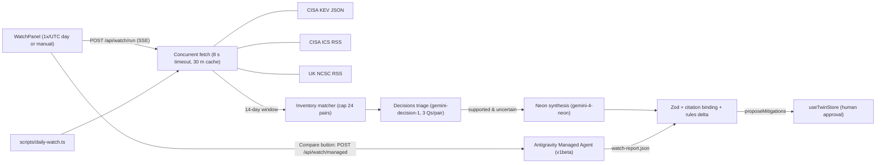
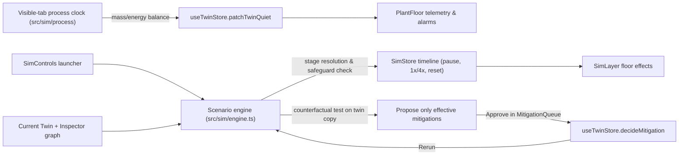

# Pyre Witness — Architecture

This document maps the implemented codebase, shared contracts, data flows, deterministic rules, tabletop scenarios, and evaluation harness.

## Directory map

| Path | Responsibility |
| --- | --- |
| `src/app/` | Next.js 16.4 App Router entry pages (`/`, `/gallery`, `/proof`, `/capture`) and server-only API routes (`/api/analyze`, `/api/reassess`, `/api/fit`, `/api/handoff/*`, `/api/voice/*`, `/api/watch/*`). |
| `src/shell/` | Client root (`dynamic(..., { ssr: false })`), error-isolated lazy `<Slot>` wrappers, top bar, view switcher, responsive results rail, and brand mark. |
| `src/twin/` | Digital twin data model (`types.ts`), Zustand twin store (`store.ts`), drop-pin store (`dropPoint.ts`), pure floor geometry (`geometry.ts`), immutable mitigation engine (`effects.ts`), and the 92-asset seed plant (`seed.ts`, `seed/`). |
| `src/equipment/` | 29 hand-drawn parametric SVG equipment symbols (16 process, 6 control/network, 7 user devices), `SymbolFrame`, shared LED/motion CSS, and `/gallery` contact sheet. |
| `src/floor/` | Top-down 1600 x 1000 SVG plant floor schematic: camera pan/zoom/gestures, room/overlay zones, animated orthogonal pipes, media legend, attack paths, entry points, and drag-to-reassess. |
| `src/purdue/` | Linked Purdue Enterprise Reference Architecture map (Levels 0–5 + L3.5 DMZ): cell columns, collapsible Level 0 groups, conduit gates, attack-path overlays, and drag-to-relevel. |
| `src/rules/` | Pure TypeScript Inspector rules engine (browser + server): 13 rules (`rules/*.ts`), compliance resolver, BFS reachability graph, ordinal 0–100 risk index, and `rankPlacements`. |
| `src/data/` | Checked-in reference datasets: MITRE ATT&CK for ICS v20.1 (`attack-ics.ts`, 104 techniques) and a 58-clause compliance catalogue (`compliance.ts`). |
| `src/gemini/` | Model registry (`models.ts`), GenAI SDK transport and retry helpers (`transport.ts`), Zod schemas (`schemas.ts`), Decisions/Hydrogen capture calls (`capture.ts`), and Carbon/Neon assessment calls (`assess.ts`). |
| `src/pipeline/` | Shared pipeline contracts (`types.ts`), browser event bus (`bus.ts`), run store (`runStore.ts`), browser SSE client (`client.ts`), profile-to-asset mapper (`assetFromProfile.ts`), and server orchestration (`server/`). |
| `src/link/` | Server-side SSRF-guarded product URL fetcher (`safeFetch.ts`), HTML/JSON-LD/spec-table extractor (`extract.ts`), and main-image downloader (`image.ts`). |
| `src/capture/` | Floating desktop capture card, on-demand camera, drag/drop/paste photo drafts, shared JPEG encoder (<= 1600 px, q=0.85), floor drop-pin chip, and phone QR receiver. |
| `src/handoff/` | Same-LAN phone-to-desktop photo handoff wire format, bounded upload reader, 10-minute in-memory mailbox, and SSE stream client. |
| `src/panel/` | Right-hand results rail: sticky `RiskDial`, Chief briefing card, progressive device/placement/exclusion/risk/path/compliance cards, `MitigationQueue`, and `AssetInspector`. |
| `src/crew/` | Four crew avatars (Scout, Architect, Inspector, Chief), floor pathfinder and desk office, `pipelineBus` director, `idle patrol` sampler, and 200-entry `ActivityFeed`. |
| `src/sim/` | Living process mass/energy balance loop (`process/`), deterministic tabletop incident engine (`engine.ts`, `scenarios/`), floor overlays (`SimLayer.tsx`), and transport dock (`SimControls.tsx`). |
| `src/watch/` | Daily Threat Watch: concurrent CISA KEV / CISA ICS / UK NCSC fetchers (`feeds/`), seed inventory matcher, Decisions triage, Neon synthesis, Antigravity remote-agent runner, and `WatchPanel`. |
| `src/fit/` | On-demand photorealistic installation preview (`FitPreview.tsx`, lightbox, LRU cache, twin-grounded prompt builder) backed by `gemini-nano-banana-2.1`. |
| `src/voice/` | Spoken Chief briefing (`SpeakButton.tsx`, WAV cache) and push-to-talk Live voice (`TalkToChief.tsx`, PCM16 worklet, ephemeral tokens, 5 validated client tools). |
| `src/proof/` | Server-loaded `/proof` report UI (`ProofReport`, `MetricBars`, `FailureGallery`, `reportSource.ts`) reading `eval/report/latest.json`. |
| `eval/` | Paired evaluation harness (`run.ts`, `baseline.ts`, `system.ts`, `judge.ts`, `metrics.ts`, `statistics.ts`, `validate.ts`), 71-item dataset (`dataset/`), and report output (`report/`). |
| `scripts/` | Standalone CLI runners: `smoke-pipeline.ts` (text, photo, or link pipeline check) and `daily-watch.ts` (headless cron Threat Watch writing `watch/reports/<UTC-date>.json`). |

## Shared contracts

### Digital twin model (`src/twin/types.ts`, `geometry.ts`, `effects.ts`)

- **Canvas and scale:** `Twin.plant.canvas` is `1600 x 1000` SVG user units (`10 units = 1 m`), with an outer building rectangle separating indoors from outdoors.
- **Areas (`AreaId`):** 13 areas across three kinds:
  - Process (5): `water_treatment`, `syrup_room`, `blending`, `filler3`, `packaging`.
  - Support (4): `utilities`, `control_room`, `corporate_office`, `crew_office`.
  - Context overlays / exterior (4): `parking_lot`, `visitor_corridor`, `nh3_hazard` (inside `utilities`), `washdown` (inside `filler3`).
  - Each area carries `AreaAttrs` (`publicAccess`, `outdoor`, `restricted`, `washdown`, `hazard`, `foodContact`) and `typicalLevels: PurdueLevel[]`.
- **Dual-presence assets (`Asset`):** Every asset has both `physical` (`area`, `x`, `y`, `rotation`, `kind` from 29 `EQUIPMENT_KINDS`, `connections` across 9 `Medium` types) and `network` (`level` in `0 | 1 | 2 | 3 | 3.5 | 4 | 5`, `area` zone name, `conduit`), plus optional `cyber`, `process`, `specs`, `criticality` (`1..5`), `safetyCritical`, and `protections` (independent physical/hardwired safeguards).
- **Seed plant (`src/twin/seed.ts`):** 92 assets, 13 areas, 6 `EntryPoint` origins (`internet`, `parking_rf`, `visitor`, `vendor_remote`, `supply_chain`, `insider`), 75 connections, and 10 conduits, including 3 deliberate weaknesses (`C-F3-PACK` unenforced L2 bridge, `GW-PK` unmanaged cellular modem bypassing the DMZ, and `HMI-F3` exposed USB port at the visitor observation window). Baseline Inspector score: **46.09 / 100 (elevated)**.
- **Pure mutations (`src/twin/effects.ts`):** `applyEffects(twin, effects)` immutably applies 9 `MitigationEffect` operations: `move_asset`, `disable_radio`, `patch_cyber`, `remove_connection`, `remove_asset`, `enforce_conduit`, `set_area_attr`, `add_protection`, and `note`.

### Pipeline contracts (`src/pipeline/types.ts`)

- **Inputs:** `CaptureInput` is a discriminated union of `photo` (1–3 base64 images), `link` (`url` + optional `note`), or `text` (`description`). `AnalyzeRequest` sends `{ input, twin, dropPoint? }` to `POST /api/analyze`; `ReassessRequest` sends `{ profile, twin, assetId, placement }` to `POST /api/reassess`.
- **Model schemas (snake_case):** `GateResult` (Decisions API answers + `proceed` boolean), `DeviceProfile` (Scout output across 15 `DEVICE_CATEGORIES`, 6 `RADIOS`, ports, specs, `evidence[]`, `unknowns[]`), `Assessment` (Architect output: `placement`, `physical_placement`, `never_place[]`, `risks[]`, `attack_paths[]`, `compliance[]`, `mitigations[]`), and `SelfCheckResult` (Inspector findings, paths, `disagreements[]`, `revised`).
- **Event stream (`PipelineEvent`):** 19 typed events across 7 stages (`link`, `gate`, `perception`, `reasoning`, `selfcheck`, `revision`, `summary`): `run.started`, `link.started`, `link.fetched`, `gate.started`, `gate.done`, `perception.started`, `perception.done`, `reasoning.started`, `reasoning.thought`, `reasoning.done`, `selfcheck.started`, `selfcheck.path`, `selfcheck.done`, `revision.started`, `revision.done`, `summary.started`, `summary.done`, `run.completed`, `run.error`.

### Stores and event bus

| Store / bus | File | Responsibility |
| --- | --- | --- |
| `useTwinStore` | `src/twin/store.ts` | Holds `twin`, live `risk` (recomputed via `evaluateTwin` on every mutation), `baselineScore`, linked `selectedId` / `hoveredId` / `highlightIds`, active `view` (`floor` / `purdue` / `split`), and `mitigations` queue. `patchTwinQuiet` updates high-frequency telemetry without re-running rules. `decideMitigation` is the sole path that applies or rejects proposals. |
| `useRunStore` | `src/pipeline/runStore.ts` | Reduces incoming `PipelineEvent` frames into `status`, `stage`, `events`, `gate`, `profile`, `assessment`, `selfCheck`, `summary`, `placedAssetId`, and `captureThumbnail`, then emits every event on `pipelineBus`. |
| `pipelineBus` | `src/pipeline/bus.ts` | Synchronous pub/sub bridge from `useRunStore.ingest` to `src/crew/director.ts` and `src/voice/SpeakButton.tsx`. |
| `useDropStore` | `src/twin/dropPoint.ts` | Arms floor pin selection and holds `DropPoint` (defaults to `DEFAULT_DROP` at `(700, 640)` in `filler3`). |
| Feature stores | `src/crew/`, `src/sim/`, `src/watch/`, `src/voice/` | `useCrewStore`, `useFeedStore`, `useSimStore`, `useWatchStore`, and `useChiefPath`. |

## Data flows

### Capture, analysis pipeline, twin, and views

```mermaid
flowchart LR
  Phone["Phone /capture (LAN QR)"] -->|"POST /api/handoff/:code"| Handoff["Handoff mailbox + SSE"]
  Handoff --> Capture["CaptureCard (photo / link / text)"]
  Drop["DropPin (useDropStore)"] --> Capture
  Capture -->|"POST /api/analyze (SSE)"| Link["Optional link fetch (src/link)"]
  Link --> Gate["Decisions Gate (gemini-decision-1)"]
  Gate -->|"proceed"| Scout["Scout (gemini-4-hydrogen)"]
  Scout --> Architect["Architect (gemini-4-carbon)"]
  Drag["Floor / Purdue drag"] -->|"POST /api/reassess (SSE)"| Architect
  Architect --> Ground["groundAssessment (ID & ATT&CK filter)"]
  Ground --> Inspector["Inspector (src/rules/engine.ts)"]
  Inspector -->|"disagreements & interactionId"| Revise["One Carbon revision (previous_interaction_id)"]
  Revise --> ReCheck["Repeat Inspector check"]
  Inspector -->|"no disagreements"| Chief["Chief briefing (gemini-4-neon)"]
  ReCheck --> Chief
  Chief --> SSE["Browser SSE client (src/pipeline/client.ts)"]
  SSE --> RunStore["useRunStore + pipelineBus"]
  SSE -->|"place asset & queue mitigations"| TwinStore["useTwinStore (auto evaluateTwin)"]
  RunStore --> Crew["CrewLayer + ActivityFeed"]
  RunStore --> Panel["SidePanel + FitPreview + SpeakButton"]
  TwinStore --> Floor["PlantFloor"]
  TwinStore --> Purdue["PurdueMap"]
  TwinStore --> Panel
  Panel -->|"Approve / Reject"| TwinStore
```

### Daily Threat Watch

### Living process and tabletop simulation

## Inspector rules engine (`src/rules/`)

`evaluateTwin`, `evaluatePlacement`, `rankPlacements`, and `explainRule` run identically in the browser and on the server. Every emitted technique resolves against `src/data/attack-ics.ts` (v20.1), and rule citations resolve through `src/rules/compliance.ts` against `src/data/compliance.ts`.

| Rule | Kind | Condition | Control references (code / log) | ATT&CK for ICS |
| --- | --- | --- | --- | --- |
| `RF-01` | cyber | Wi-Fi, Bluetooth, cellular, Zigbee, or LoRa at Purdue 0–3 within an RF entry radius or 30 m of a public or outdoor area | IEC 62443-3-3 SR 1.6, SR 2.2; NIST SP 800-82r3 §6.2.9 | `T0860` |
| `ZONE-01` | cyber | Cloud or remote access at Purdue 0–3 without an evidenced, enforced route to a Level 3.5 zone | IEC 62443-3-3 SR 5.1, SR 5.2; NIST SP 800-82r3 §5.2.3, §6.2.10 | `T0822` (remote), `T0883` (cloud/internet) |
| `ZONE-02` | cyber | Flat or unenforced connectivity across zones of different consequence or OT/IT trust | IEC 62443-3-3 SR 5.1, SR 5.2; NIST SP 800-82r3 §5.2.3 | `T0886` |
| `ZONE-03` | cyber | Asset Purdue level falls outside the declared area's `typicalLevels` | IEC 62443-3-2 Section 4 (ZCR); NIST SP 800-82r3 §5.2.3 (log also cites IEC 62443-3-3 SR 5.1) | — |
| `CRED-01` | cyber | Known default credentials on an asset with modeled network connectivity | IEC 62443-3-3 SR 1.5; NIST SP 800-82r3 §6.2.1 (log cites §6.2.1.4.5) | `T1694.001` |
| `USB-01` | cyber | Removable media or exposed media interface in OT; escalated near public access | IEC 62443-3-3 SR 2.3; NIST SP 800-82r3 §6.2.7 (log also cites NIST SP 1334) | `T0847` |
| `PHYS-01` | physical | Documented exposed port inside or within 5.5 m (5 m + 0.5 m tolerance) of a public-access area | NIST SP 800-82r3 §5.2.2; NIST CSF 2.0 PR.AA (log also cites NIST SP 800-53 Rev. 5 PE-3) | `T0864` |
| `TRANS-01` | cyber | Unmanaged laptop or phone with modeled network connectivity at Purdue 0–2 | IEC 62443-3-3 SR 2.3; NIST SP 800-82r3 §6.2.1 | `T0864` |
| `CAM-01` | cyber | Camera within 10 m of an HMI or keypad in the same room, or using a cloud service in OT | IEC 62443-3-3 SR 4.1; NIST SP 800-82r3 §5.2.2 (log cites §6.2.3) | `T0882` |
| `HAZ-01` | compliance | Potential ignition source in an `NH3` hazard area without recognizable gas-area marking (Class I Div/Zone, ATEX/IECEx, Ex) | NFPA 70 Art. 500 & 505; IEC 60079-14; ANSI/IIAR 2 Ch. 6; OSHA 29 CFR 1910.119(d) (log also cites 1910.307) | — |
| `WASH-01` | compliance | Missing IP69K/high-pressure washdown or 316L hygienic material evidence in a washdown zone, or explicitly non-food-grade equipment within 5 m of open product | FDA 21 CFR 117.40(a); EHEDG Doc. 8 & 13; 3-A Sanitary Standards; IEC 60529; ISO 20653 | — |
| `SAFE-01` | physical | At least one modeled attack path reaches a safety-critical asset (severity 5) | IEC 61511-1 (SIS Separation & Security); IEC 62443-3-3 SR 5.1 (log also cites NIST SP 800-82r3 §2.3.7) | `T0880` |
| `MGMT-01` | cyber | Cyber profile explicitly marks an OT device as unmanaged (`managed: false`) | IEC 62443-2-1 Asset Owner Program; NIST CSF 2.0 ID.AM (log cites NIST SP 800-82r3 §§6.1.1 & 6.2.11) | — |

### Reachability graph and risk index

- **Graph:** Bidirectional active network links, same-zone attachment when cables are omitted, conditional RF association for exposed Wi-Fi, and unenforced conduits. An explicit disabled link overrides inferred connectivity; enforced conduits block lateral traversal because conduit allowlists are free text.
- **Traversal:** Bounded BFS up to 6 hops from the 6 entry points to criticality 4–5 or safety-critical targets. Plant reports retain the strongest route per `(entry, mechanism, target)` plus one representative route per added entry landing.
- **Score formula:** `E = sum(max severity^2 per rule+asset, excluding SAFE-01) + sum(max severity * likelihood per entry+mechanism+target)`. Plant score is `round(100 * E / (600 + E), 2)` with bands at `0` (low), `20` (guarded), `40` (elevated), `60` (high), and `80` (critical). Area scores apply the same formula locally.

## Tabletop scenarios (`src/sim/scenarios/`)

The engine resolves stages from live inventory, Inspector graph evidence, and `Asset.protections` flags, halting at the first safeguard that holds. The stock seed plant contains all five UI scenarios; modifying the twin (or approving proposed mitigations) changes whether and when containment occurs.

| ID | UI label | Exposed in `SimControls` | Modeled threat and consequence | Safeguards credited |
| --- | --- | --- | --- | --- |
| `cip` | CIP Crossover | Yes | Modeled control exposure + connected CIP branch during active filling -> caustic conductivity excursion, held product, filling stop. | Controller isolation, positive CIP branch segregation (`cip-branch-isolation`), or existing `ZSC-311` hardwired closed permissive. |
| `ammonia` | NH3 Release | Yes | Release challenge in `nh3_hazard` zone (`C-1`) -> NIOSH 300 ppm IDLH reference indicator; checks detector availability and zone equipment suitability. | Independent local detection (`independent-gas-detection`), local ventilation (`emergency-ventilation`), or available local response without network exposure. |
| `ransomware` | Site Ransomware | Yes | Endpoint availability loss propagating across cells reachable in the Inspector graph -> loss of supervision or cell stop. | Managed maintenance admission, enforced DMZ boundaries, and inter-cell segmentation. |
| `wireless` | Rogue Wireless | Yes | Public `parking_rf` reach to an OT radio, then to `HMI-F3` and `PLC-F3` -> out-of-band filling rate while filling is active. | No in-range OT radio, separation from Filler 3 cell/controller, or idle filling. |
| `chiller` | Chiller Trip | Yes | Duty cooling (`C-1`) interruption -> checks standby (`C-2`) availability; warm product excursion and filling stop. | Available standby refrigeration with modeled connections and local control (`independent-standby-cooling`). |
| `carbonation` | CO2 Upset | No (`ALL_SCENARIOS` only) | Supervision/control challenge to `PLC-BL` while carbonation train (`CC-301`, `HX-401`, `FIL-3`) runs -> over-pressure (`PT-301`, `T0836`), relief demand, foaming (`QT-301`), batch hold. | Blend cell segmentation (`C-OPS-BLEND`), inactive carbonation train, or `independent-pressure-protection` on `CC-301`. |

## Evaluation design (`eval/`)

- **Dataset (`eval/dataset/`):** 71 validated items (`npx tsx eval/validate.ts`):
  - **54 Wikimedia Commons photos:** 46 positive devices across 14 categories + 8 negative non-devices (mug, potted plant, chair, landscape, defocused photo, handwritten letter, cardboard box, traffic cone), stratified into 27 `clean`, 16 `messy`, and 11 `edge`.
  - **9 project-authored text captures:** 3 `clean`, 4 `messy`, 2 `edge`.
  - **8 live product URLs:** 2 tanks, 2 field instruments, 2 network cameras, 2 industrial gateways (scored as their own `link` group).
- **Paired comparison:** For each selected item, `eval/run.ts` alternates execution order across up to 3 concurrent workers between:
  - **`baseline` (`eval/baseline.ts`):** Single structured `gemini-4-hydrogen` call given the same capture and compact seed twin.
  - **`system` (`eval/system.ts`):** Full production `runAnalyze` pipeline (link fetch, Decisions gate, Scout, Architect, Inspector self-check + optional Carbon revision, Chief).
- **Independent judging and rule check:**
  - Free-text `device_type` accuracy is scored by an anonymized `gemini-decision-1` call (`eval/judge.ts`) comparing both sides against ground truth.
  - Both sides' recommendations are checked post-hoc with `evaluatePlacement` to measure `ruleConsistency`.
- **Metrics and statistics (`eval/metrics.ts`, `statistics.ts`):** 22 metrics total, with 5 headlines (`gateAccuracy`, `physicalKindAccuracy`, `physicalAreaAccuracy`, `ruleConsistency`, `riskRecall`), plus false accept/reject rates, category accuracy, Decisions device-type match, radio precision/recall/F1, port F1, default credentials, cloud flag, Purdue-level accuracy, never-place violation rate, ATT&CK citation validity and hallucination, placement coverage, capacity/size match, and execution failure rate. Reports Wilson 95% confidence intervals (Jaccard-to-F1 transformed for set F1) and paired bootstrap intervals across difficulty splits.
- **Caching and publication:** Cache keys hash input bytes, relevant source files, and `SEED_TWIN`, supporting `--limit N` (deterministic stratified round-robin), `--only baseline|system`, and `--resume`. Completed runs atomically write `eval/report/REPORT.md` and `eval/report/latest.json`, which `/proof` (`src/app/proof/page.tsx`) reads at request time along with up to 6 diagnosed failure cases.
