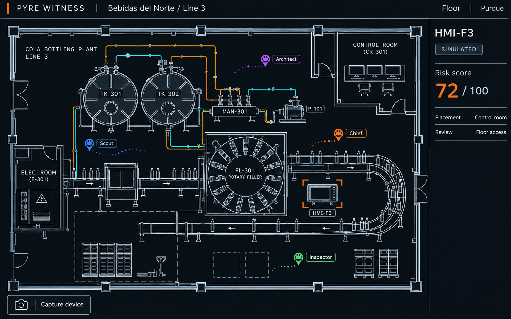
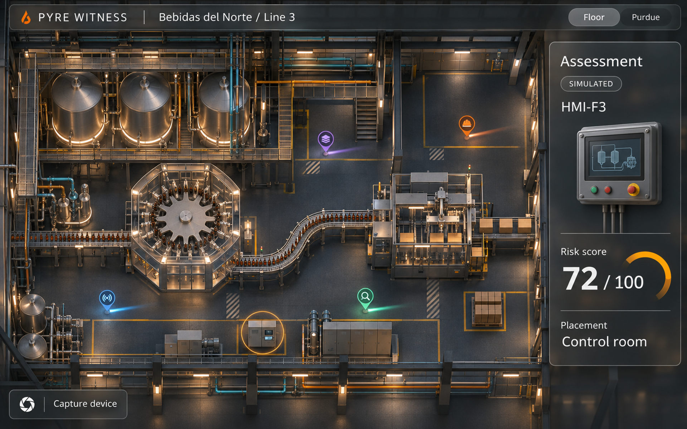
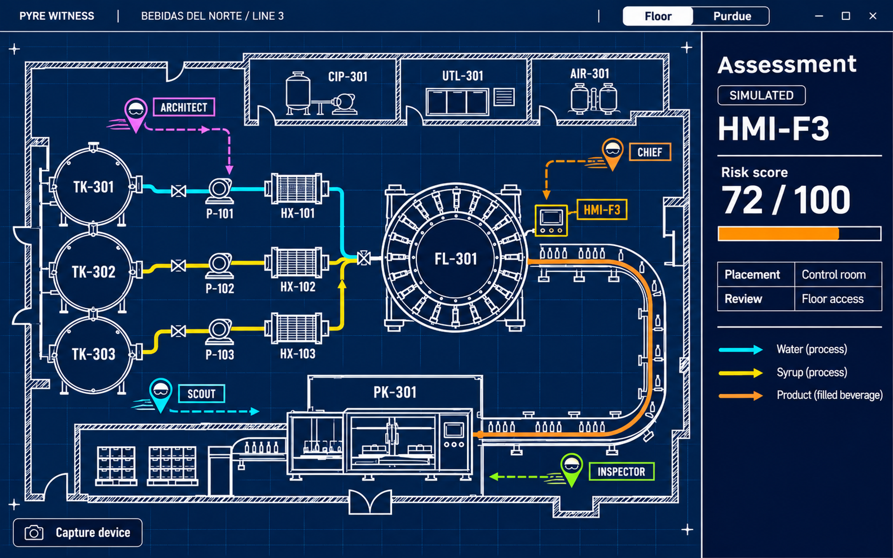
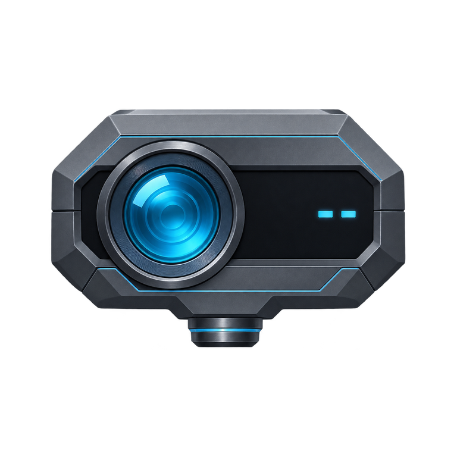
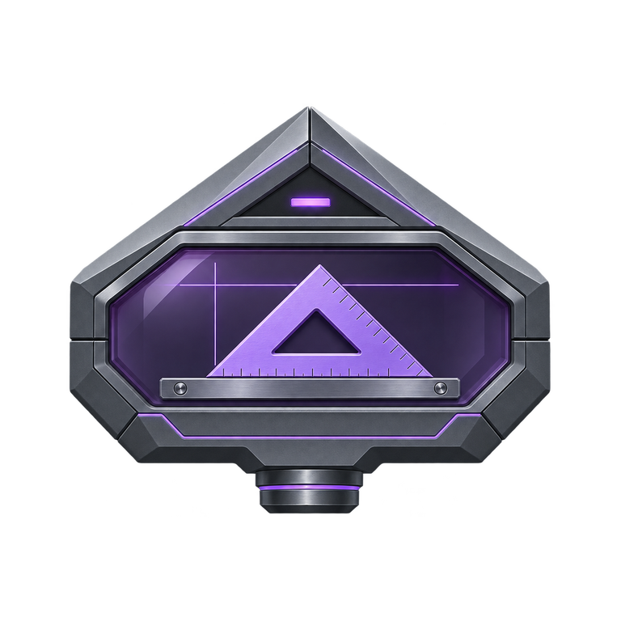
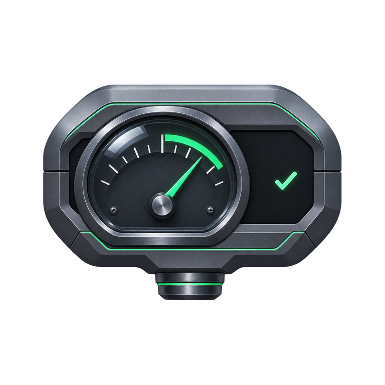
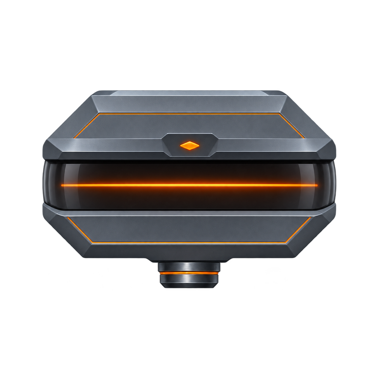

# Pyre Witness art index

**Recommended direction — Concept 1.** Follow the amber brackets from HMI-F3 on the floor to its score on the right. All four crew names remain readable along the way.

| 1 · Engineering drawing at night | 2 · Control-room glass | 3 · High-contrast blueprint |
| --- | --- | --- |
|  |  |  |
| Best for locating a device and reading its assessment. | Best for recognizing the machines and their scale. The warm highlights compete with the crew pins. | Best for tracing media at a distance. Bold walls and labels compete with the selected device. |

## Asset register

| File | Pixels | Description |
| --- | ---: | --- |
| [public/brand/mark.png](../../public/brand/mark.png) | 1024 × 1024 | Single ember-orange flame forms the upper lid of a watching eye. |
| [public/brand/mark-dark.png](../../public/brand/mark-dark.png) | 1024 × 1024 | Padded app icon with the ember eye on a solid graphite field. |
| [public/brand/wordmark.png](../../public/brand/wordmark.png) | 2400 × 600 | An orange emblem precedes widely spaced, light-gray lettering. |
| [public/crew/scout.png](../../public/crew/scout.png) | 768 × 768 | A blue camera lens and two status lights identify the perception crew member. |
| [public/crew/architect.png](../../public/crew/architect.png) | 768 × 768 | A violet set square and straightedge identify the reasoning crew member. |
| [public/crew/inspector.png](../../public/crew/inspector.png) | 768 × 768 | A green dial, calibrated needle and check identify the deterministic rules engine. |
| [public/crew/chief.png](../../public/crew/chief.png) | 768 × 768 | A thin orange command visor and a small ember identify the briefing crew member. |
| [demo/assets/title-card.png](../../demo/assets/title-card.png) | 1920 × 1080 | The wordmark and product line sit between a cropped manifold and a rotary filler. |
| [demo/assets/end-card.png](../../demo/assets/end-card.png) | 1920 × 1080 | The Gemini credit sits above a clear lower quarter reserved for the demo URL. |
| [public/brand/hero.png](../../public/brand/hero.png) | 1600 × 900 | Three media lines feed the rotary filler, and a dashed red route ends at HMI-F3. |
| [docs/concepts/concept-1.png](concept-1.png) | 1920 × 1200 | Restrained night drawing with four named crew pins and an amber bracket around HMI-F3. |
| [docs/concepts/concept-2.png](concept-2.png) | 1920 × 1200 | A softly lit plant cutaway sits beneath a translucent assessment panel. |
| [docs/concepts/concept-3.png](concept-3.png) | 1920 × 1200 | Bright media lines and white equipment outlines share a deep-blue drafting grid. |

## At delivery size

 &nbsp;    

The eye aperture stays open at 16 px. Inspector’s green needle remains visible at 32 px, but its separate verification check is the first detail to disappear. Of the full-screen boards, I am least happy with Concept 3 because the white walls draw attention away from HMI-F3. The hero uses shallow relief to make the bottling equipment recognizable. All three concept scores are labeled **SIMULATED**.

## Generation prompts and finishing

The artwork was generated with the built-in image generator. Its interface exposed no model-version selector or seed. The prompts below reproduce the art direction. New generations can vary.

For the crew, keep 8 source pixels of padding around each portrait’s alpha ≥ 100 bounding box. Resize to 605 px wide with Lanczos3, center on a transparent 768 px square and export as RGBA PNG. The video subtitles were typeset after generation and checked against the supplied copy. All final PNGs use compression level 9.

<strong>mark.png</strong>

Transparent generation. Keep the two largest alpha components. At the source resolution, use an alpha threshold of 156, a 3 px median filter and a 0.75 px Gaussian blur on the edges. Reduce the iris to 84% of its original width about its center. Center the silhouette in an 875 px-wide box and set the ink to #ff7a2f.

> Use case: logo-brand. Design the primary symbol alone for PYRE WITNESS, an industrial inspection instrument. A compact, unmistakable watching eye fused with a single wind-swept ember. Build the lower mass as a broad pointed almond eye; its upper contour lifts into one decisive asymmetric flame tip slightly right of center. Carve out one large almond-shaped transparent aperture inside the mass, framing a substantial solid round orange iris. The eye and flame must read as ONE spare silhouette, with three or fewer simple filled shapes. Bold optical proportions, no delicate tips inside, readable as a 16-pixel favicon. Flat solid #ff7a2f only; all other pixels genuinely transparent. Square canvas, artwork centered, approximately 77 percent of width, calm intentional clearspace. Precise engineered curves with a memorable asymmetric profile. No writing, no outline box, no texture, shading, gradient, shadow, highlights, spark particles or other graphics. Original identity.

<strong>mark-dark.png</strong>

The first mark generation served as the image reference for this layout proof. For the final tile, reduce the finished transparent mark to 805 × 805, place it at (110, 110) and composite its alpha over flat #070b10. This keeps the iris identical across the two exports.

> Use case: logo-brand. Set the exact supplied Pyre Witness ember-eye symbol centered on a perfectly uniform #070b10 square icon tile. Preserve every detail of the silhouette, including the round circular iris, almond aperture and single wind-swept crest. Solid flat #ff7a2f mark. Use comfortable balanced padding of 18 percent on all four sides. No bevels, no glows, no border, no words; original identity.

<strong>wordmark.png</strong>

Use the first mark generation as the reference, with transparent output. Keep the generated eleven letter shapes, add 9 source pixels of tracking between consecutive letters, use #d7e1ec ink, and replace the proof’s emblem with the finished mark. Center the 2160 px-wide lockup on the transparent canvas.

> Use case: logo-brand. Design a wide horizontal wordmark reading exactly “PYRE WITNESS”. Place the supplied orange flame-eye mark on the left, preserving its silhouette precisely. To its right, one line of uppercase lettering in soft light steel gray #d7e1ec. Draw a quiet extended neo-grotesque in medium weight, geometric and optically spaced, with wide tracking, a distinctive clean R leg and generous word space. No stencil effects, ligatures or sci-fi cuts. The height of letters is about 56% of the height of the mark, centered vertically against it. Balanced, legible, industrial. Frame as a 4:1 horizontal wordmark with generous even clearspace on all sides. Transparent canvas. Flat color only. Nothing else.

<strong>scout.png</strong>

Generate this portrait first with transparency enabled. Its original full-size image is the reference for the other three crew members.

> Square avatar for SCOUT, the perception instrument in Pyre Witness, an industrial plant digital twin. Design a single original, beautifully reduced machine portrait: a short wide hard-shell instrument head with clipped upper corners, a low chin-like centered mounting connector, and a large circular camera lens set slightly to the left in a black horizontal visor. The blue glass and its concentric machined rings must dominate. Two tiny rectangular status lights on the right balance the optic. Centered straight-on orthographic elevation, floating alone, no torso or stand. As a family design language use thick satin graphite cast housings, a few broad facets, fine cool steel-blue edge lines, precise panel seams, and one class of luminous colored glass, here sky blue #4cc3ff. Treat it like an illustrated emblem in a premium industrial equipment service manual: crisp simplified planes with just enough tactile depth, clean chamfers, a silhouette readable at 32 pixels. Calm object design, deliberate asymmetry, no eyes or face, no mouth, no cosplay, no sci-fi armor, no character expression. Maximal object width 73% and height 68% of square, center the complete object with wide even clear margins for a circular crop. Isolated on true transparent alpha, no drop shadow, text, letters, numbers, badge ring or backdrop.

<strong>architect.png</strong>

Use the original Scout portrait as the reference, with transparency enabled.

> Reference image is SCOUT, the first portrait in this four-member industrial plant crew. Create a distinct sibling instrument head, as an original single isolated square avatar. ARCHITECT is the reasoning instrument. Give it a distinctive peaked, tent-like top housing like a drafting set-square, with a front smoked-violet drafting visor. Build its emblem from one bold physical violet #a78bfa triangular set-square with a cutout at its center, a resting straightedge and just two fine blueprint construction lines on the lens. The triangular geometry should identify it at a glance. Restrict accent lighting to violet. Match Scout's scale, finish and visual language: straight-on orthographic elevation, satin graphite cast housing, cool steel-blue chamfers, clean planes, one short centered mounting connector under the head. Make the silhouette and working instrument unmistakably different from the camera. Complete object occupies roughly 73% of the square width, centered with wide margins for circular cropping. Premium industrial design engineering manual emblem, minimal and tactile. No humans, eyes, mouth, torso, arms, backdrop, drop shadow, badge frame, letters, numbers, real logos or watermarks. True transparent alpha.

<strong>inspector.png</strong>

Use the original Scout portrait as the reference, with transparency enabled.

> Reference image is SCOUT, the first portrait in this four-member industrial plant crew. Create a distinct sibling instrument head, as an original single isolated square avatar. INSPECTOR is the deterministic rules engine. Design a rounded squat cast metering head with a large recessed physical analog gauge under glass. Show one luminous mint green #34d399 needle and a short array of clear radial calibration ticks, a green safe-range arc and a single small green check indicator on the adjoining dark panel. Keep this a calm, precise inspection instrument. Restrict accent lighting to green. Match Scout's scale, finish and visual language: straight-on orthographic elevation, satin graphite cast housing, cool steel-blue chamfers, clean planes, one short centered mounting connector under the head. Make the silhouette and working instrument unmistakably different from the camera. Complete object occupies roughly 73% of the square width, centered with wide margins for circular cropping. Premium industrial design engineering manual emblem, minimal and tactile. No humans, eyes, mouth, torso, arms, backdrop, drop shadow, badge frame, letters, numbers, real logos or watermarks. True transparent alpha.

<strong>chief.png</strong>

Use the original Scout portrait as the reference, with transparency enabled.

> Reference image is SCOUT, the first portrait in this four-member industrial plant crew. Create a distinct sibling instrument head, as an original single isolated square avatar. CHIEF is the briefing and command instrument. Give this head a strong low stepped brow and an uninterrupted wraparound smoked-graphite command visor with a single narrow horizontal ember-orange #ff7a2f illuminated slit. An inset small glowing ember-shaped lozenge above the center of the visor provides its unique identifier. Lower shell is a smooth chamfered slab. Restrict accent lighting to ember orange. Make this the quietest and simplest crew member. Match Scout's scale, finish and visual language: straight-on orthographic elevation, satin graphite cast housing, cool steel-blue chamfers, clean planes, one short centered mounting connector under the head. Make the silhouette and working instrument unmistakably different from the camera. Complete object occupies roughly 73% of the square width, centered with wide margins for circular cropping. Premium industrial design engineering manual emblem, minimal and tactile. No humans, eyes, mouth, torso, arms, backdrop, drop shadow, badge frame, letters, numbers, real logos or watermarks. True transparent alpha.

<strong>title-card.png</strong>

Generate the opaque background. Center-crop to 1920 × 1080. Set the finished lockup 1260 px wide, centered at (960, 471). Center “Snap any device. See where it belongs. See what it risks.” at (960, 626) in 39 px Helvetica Neue, #c5d2df, with 0.234 px tracking.

> Use case: ads-marketing. Background art plate for a minimal 16:9 cinematic title card about a bottling-plant digital twin called Pyre Witness. The typography and identity will be professionally composited afterward, so leave all lettering and logos out. Wide 1920 by 1080 composition, orthographic overhead precision drawing on a deep near-black graphite navy (#070b10) field. A beautifully resolved cropped arc of a large rotary filler with tiny circular nozzles enters the lower right corner, and a few delicate parallel pipe runs enter from the upper left edge. Use subdued steel-blue engraved lines, subtle blueprint registration ticks and filmic tonal depth. Draw the machine clearly only in the outermost quarters, softly fall off into darkness toward the center. The central 70% width by 55% height is calm, almost flat #070b10 negative space for the centered brand. Industrial, restrained, architectural engineering detail at the frame edges. No saturated lights, maps of networks, mountains, cast shadows, lettering, slogans, icons, numbers, or photo texture.

<strong>end-card.png</strong>

Generate the opaque background. Center-crop to 1920 × 1080. Set the finished lockup 1200 px wide, centered at (960, 449). Center “Built with Gemini 4: Hydrogen, Carbon, Neon and the Decisions API” at (960, 596) in 34 px Helvetica Neue, #c5d2df, with 0.234 px tracking.

> Use case: ads-marketing. New 16:9 cinematic closing-title background plate from a restrained industrial engineering film. Its companion opening frame has barely-lit steel construction lines on graphite navy. This end frame is quieter still: an orthographic pipe manifold with two tank circles and fine machine-registration geometry is cropped by the upper right corner; two or three quiet conduit lines run briefly up the left edge. Fine blue-steel ink against near-black #070b10, a very subtle printing-grain texture at the edges. Precisely plotted, minimal, elegant. The whole middle and the entire lower quarter are clear dark negative space, set aside for a lockup, credits and a future URL, which will all be professionally typeset after generation. No text, no logos, numbers, symbols representing words, colored lights, boxes or placeholder marks. Wide 1920 by 1080 composition.

<strong>hero.png</strong>

Generate the first image with an opaque background. Use that output as the reference for the second prompt. Center-crop and resample the 1672 × 941 result with Lanczos3.

**Initial prompt**

> Create a 16:9 landscape editorial key visual for Pyre Witness, a fictional industrial bottling-plant digital twin. A true orthographic overhead cutaway, like an exceptional industrial atlas plate rendered at night. The wide composition reads across a single connected production floor: three round brushed steel liquid tanks clustered asymmetrically at left with manway covers, a small blending skid and pumps in the middle, one magnificent large open rotary bottling filler with a precise ring of evenly spaced bottle positions at center-right, and a curved slat conveyor carrying closely spaced glass bottles toward packaging. Thread three recognizable process pipes around the equipment, cyan water, amber syrup and muted copper-brown product. Graphite-navy ground #070b10, deep midnight floor, fine steel-blue #93a7bc drafting edges, machined material highlights, faint plan grid, precise walls and door swings, real depth from soft occlusion. Steel feels tangible; pipes remain discrete and legible. Compose the drawing nearly edge-to-edge, with clear walkways and some visible exterior margin beyond the lower wall. Four and only four small luminous crew position markers sit in different walkways, visually identical compact circular beacons with a little helmet silhouette: one sky blue, one violet, one green, one ember orange. A small HMI pedestal just inside the lower-right wall has a single unmistakable alarm-red ring around it. A short series of evenly spaced red dashes starts outside the lower wall, crosses it, makes one right-angle turn and terminates at the ring. This is an abstract risk illustration on a fictional floor. One or two tiny engraved drafting tags, “TK-301” and “HMI-F3”, are the only permitted lettering. No title, no legend, no panels, no score, no large type, no commercial logos. Restrained colour, professional night-shift atmosphere, quiet precision, razor-sharp foreground and no lens blur.

**Revision prompt**

> Re-render this exact fictional bottling floor and its four coloured hardhat beacons as an exquisite overhead engineering drawing at night. Preserve the overhead arrangement, single HMI device, its red ring and red dashed route from outside the wall, the three coloured media pipes and the two tags. Change the medium and scale of detail: use fine luminous steel-blue engraving on graphite-navy, delicate layered contour lines and muted matte navy fills with just a whisper of dimensional relief. Remove large photographic highlights and concrete grain. A striking varied hierarchy of fine and medium line weights, precise bottle and pump outlines and soft engineering shadows; visual breathing room between pieces. Make the bottles credibly small against the big carousel, the equipment a little more compact, the floor walkways a little broader. Operational cyan, amber and copper-brown media pipes very legible on dark blue. Tiny crew beacons distinctly sky blue #4cc3ff, violet #a78bfa, mint green #34d399 and ember #ff7a2f. Make the alarm ring true red-pink #ff3b5c. Finished wide industrial atlas illustration with the clarity of a museum technology exhibit at night. Retain only the engraved tags “TK-301” and “HMI-F3”. No interface chrome, no new text. 16:9.

<strong>concept-1.png</strong>

Generate the first frame, then use it as the reference for the revision. Resample the full 1586 × 992 frame to 1920 × 1200 with Lanczos3.

**Initial prompt**

> Design one edge-to-edge 16:10 desktop product screenshot, 1920 x 1200 composition, of Pyre Witness, an industrial digital twin. Direction 1 — engineering drawing at night. Think of a beautifully edited plant engineer's CAD workstation: near-black graphite #070b10, extremely fine but crisp steel-blue #93a7bc vector contours on #0b1117, matte graphite panels, confident typography, small ember orange selection line. The 2D, strictly orthographic top-down architectural floor plan takes up 77% of the screen. Depict a believable cola bottling plant with thick cut perimeter walls, doors, two paired stainless vessels, manifold and pump, a highly legible rotary filler star wheel, a curved double-rail belt carrying bottles, and a small electrical room. Deliberate negative space and clear equipment silhouettes. Thin routed lines of muted cyan, amber and brown indicate process media. Four small colored instrument-helmet crew pins at distinct locations on the floor, labeled Scout (blue), Architect (violet), Inspector (green), Chief (ember); tiny subtle movement trails. Thin flat header: 'PYRE WITNESS', 'Bebidas del Norte / Line 3', 'Floor', 'Purdue'. Small floating bottom-left card with a dark outline illustration of a handheld device on left, the heading 'Capture device' and a compact camera icon on right. Slim, airy right column with 'Assessment', 'SIMULATED', 'HMI-F3', 'Risk score', a prominent '72 / 100', and two concise rows 'Placement' / 'Control room' and 'Review' / 'Floor access'. Draw exactly one selection bracket around the device in the main plant. Keep the score moderate in scale, minimal typesetting. Legible engineering tags like TK-301, P-101, FL-301. Quiet flat linework, comparable with a high-end technical drawing or architecture atlas. No art-board title, no outer margin, no perspective, no watermark, no browser window, no repeated legends, no charts, no neon, no stock photography. Finished professional interface.

**Revision prompt**

> Refine the supplied night CAD workstation screenshot into the final design. Compose to a 16:10 landscape frame. Keep the excellent large restrained graphite floor, precise fine steel linework, cyan/amber process lines, all four small labeled crew badges and sparse right sidebar. Make the floor a coherent top-down PLAN: tanks read as two large round vessel lids with manways, radial spokes and asymmetric plumbing, connected to the central star wheel then the U-shaped belt. The center-right orange selection brackets must enclose the top view of a small rectangular industrial touchscreen console, labeled exactly 'HMI-F3' inside the floor; remove the tripod camera and 'CAP-01'. Keep its matching right panel headed 'HMI-F3' and 'SIMULATED' and 'Risk score' '72 / 100', 'Placement' 'Control room', 'Review' 'Floor access'. Retain a compact floating bottom-left 'Capture device' card with a single clean camera glyph. Refine alignment and typography: a quiet regular-width grotesque for UI copy and spaced technical mono for equipment tags. The plant should be a crisp considered engineering drawing with consistent projection, no modeled lighting. Fit the entire header, plant and controls in the frame with tiny but comfortable edge insets. Keep door openings free of equipment. No extra panels, legends, duplicate controls, or decorative text.

<strong>concept-2.png</strong>

Generate in one pass with an opaque background. Resample the full 1586 × 992 frame to 1920 × 1200 with Lanczos3.

> Create a full-bleed polished software design concept, 1920x1200 16:10 landscape, for an industrial bottling plant twin called PYRE WITNESS. Direction 2: smoked control-room glass. This variant has tangible depth, like looking straight down through the glass of an architectural tabletop model. At the center of the screen a beautifully lit large top-down cutaway miniature bottling hall in dark oxidized gunmetal: sheetmetal tanks, open gantries, a large star-wheel filler with discrete bottles and a sweeping conveyor to a nearby case packer, walkable floor aisles, cream light tracing the edges of tanks. Near-black navy floor, directional soft shadows, a few cyan water pipes and amber syrup pipes. A precise orthographic 90-degree overhead camera and selective warm/cool illumination. Clearly software, no real desk or monitor. Upper-left a small glass toolbar 'PYRE WITNESS' with restrained ember symbol; along the top 'Bebidas del Norte / Line 3', a pill 'Floor' / 'Purdue'. Four little technical crew-visor pins in separate floor aisles, blue Scout, violet Architect, jade Inspector, orange Chief, with restrained halos and short motion trails. Bottom-left a small floating smoked-glass capture control with a camera aperture and 'Capture device'. A slim inset floating translucent results blade on the right, with deliberate padding, fine pale rim, layered shadow and a compact hardware illustration. Typeset 'Assessment', 'SIMULATED', 'HMI-F3', 'Risk score', a clear large '72 / 100' with a slim amber arc, 'Placement' and 'Control room'. Give the floor 76% of the width and keep it the star. Precisely one device on the floor has a subtle amber selection ring. Graceful geometry, clean grotesque type, soft light and genuine translucency, premium industrial instrumentation. No cyberpunk city, no gamer HUD, no gradients in the typography, no crowded widgets, no external brand, no browser chrome, no caption surrounding the design.

<strong>concept-3.png</strong>

Generate the first frame, then use it as the reference for the revision. Resample the full 1586 × 992 frame to 1920 × 1200 with Lanczos3.

**Initial prompt**

> Make a single finished full-frame desktop interface screenshot for PYRE WITNESS, landscape aspect ratio 16:10, designed at 1920 x 1200. Direction 3: high-contrast blueprint. An unmistakable industrial cyanotype drafting sheet on intense deep Prussian blue ink, crisp almost-white shell outlines, a few white drawing registration marks and restrained survey grid. Flat silk-screened line weights, bold condensed technical grotesque display type, purposeful rectangular geometry, no gradients. A wide compact top rail reads 'PYRE WITNESS', 'BEBIDAS DEL NORTE / LINE 3', 'Floor', 'Purdue'. Most of the screen is the strictly top-down architectural diagram of a fictional bottling line, showing a trio of circular tanks feeding pumps and heat exchangers, a large round rotary filler with tangential conveyor and packing station. Make every component legible as a distinct plan symbol using thick perimeter outlines and fine interior detail. Use bold continuous water-cyan, syrup-amber and product-copper traces, with arrowheads and valves; keep crosshatching to the cut walls. Four small walking crew visor badges at physically separate stations: blue Scout, violet Architect, green Inspector, ember Chief, each with a little directional trace. Compact floating rectangular 'Capture device' control bottom left, with camera glyph. Narrow right column in darker navy. Deliberately strong typographic hierarchy: 'ASSESSMENT', small 'SIMULATED', 'HMI-F3', 'Risk score', a bold '72 / 100' and a simple horizontal score scale. Two small fields 'Placement' / 'Control room', 'Review' / 'Floor access'. One tagged device is selected in the drawing. Use short asset tags e.g. TK-301, P-101, FL-301. Distinctive, impeccably aligned working blueprint; keep ink saturated only for process lines, crew and selected condition. No external logos, no monitor frame, no banner caption, no decorative wall of digits, no photorealistic shading.

**Revision prompt**

> Refine this Prussian-blue blueprint plant layout into a professionally typeset, high-contrast working SOFTWARE screen, 16:10 landscape. Preserve the distinctive white-on-blue technical plan with color-identified pipe routes, circular lids, rotary filler and conveyor. Keep the four small named crew markers. Reduce the top header type by half, two weights down; use clean technical grotesque across the UI, reserving condensed mono for equipment tags. Use a calm top bar, compact floor/Purdue selector and stronger layout rhythm. Make the crew markers modern little visor pins with motion tails like cartographic field workers. Make the entire plant sit comfortably inside the frame against a quieter cobalt survey grid. Change the selected asset to a small rectangular operator touchscreen at the right of the filler on the floor, framed in amber and labeled exactly 'HMI-F3'. Remove the selection from the filler. In the slim dark-navy right panel show 'Assessment', 'SIMULATED', 'HMI-F3', the principal 'Risk score' '72 / 100', and fields 'Placement' 'Control room' and 'Review' 'Floor access'. Remove the tall busy legend, keeping at most three small process-media keys, and let the lower right breathe. Reduce the equipment labels to short asset tags such as TK-301 and FL-301. Bottom-left use a small dark floating camera control with exactly one label 'Capture device'. Slightly finer white structural strokes, bold colored process-media routes, and a restrained engineering title-block treatment. Ensure it reads as a polished responsive desktop app with a dominant floor, not an industrial safety poster. No gradients, photorealism or added text.

