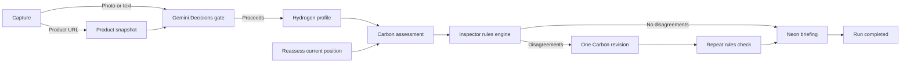

# Pyre Witness analysis pipeline



Both Node routes emit one JSON `PipelineEvent` per SSE frame. Each event carries a run ID and timestamp. The browser ingests each event into the run store and event bus. The reassessment start event retains the device's captured profile. The smoke script calls the same server runner directly.

## Model inputs and schemas

| Stage | Request and validation |
| --- | --- |
| Decisions | One shared text/image input and four questions. Zod checks the three `noul` answers and the `route` choice probabilities. The gate stops at device probability ≤ 0.15 with confidence ≥ 0.85. Weak classification or readability is advisory. |
| Scout | Evidence-only prompt for the `DeviceProfile` schema. It carries the captured text or link title and specs alongside inline images. It asks for observations, confidence and consequential unknowns. Equipment, category and radio enums come from the shared contracts. |
| Architect | The profile, current spot and compact twin carry room bounds and attributes, asset and zone facts, conduits and entry points. The prompt supplies the ATT&CK for ICS catalog and Inspector rule IDs. `Assessment` includes both placements, exclusions, risks, exposure paths, compliance and proposed effects. Paths describe possible exposure within this fictional twin. |
| Chief | The final assessment, current spot and rules findings inform two or three concise lines in the briefing schema. Unresolved blockers inform the hold condition. |

Native `response_format` is a text object with `mime_type: "application/json"` and a JSON Schema derived from Zod. Zod also validates the response on return. An invalid JSON body or schema mismatch gets one retry within the stage deadline.

## Placement and review

The server and browser derive the same compact `NEW-` tag from the run ID. Scout completion places a neutral asset at the drop point with the observed specs, provisional Purdue association and unmanaged status for connected devices. The Inspector evaluates the Architect's placement using a shared footprint-aware position finder. The browser evaluates the actual asset at its current spot before coloring it. Severity 4 or 5 blocks placement in this screen.

The server drops paths with unknown identifiers or disconnected steps and removes unknown technique tags before publication. The Inspector reports these changes, blocking recommendations and unblocked alternatives ranked at least 10 points safer or with a blocker removed. If it reports disagreements, Carbon receives the findings through `previous_interaction_id` and the Inspector checks its revision once. Reassessment also runs the Inspector against the exact current coordinates and Purdue level.

The Move action uses the shared placement finder with a near-asset anchor when available. The twin store recomputes risk after the move. Final mitigations carry stable run-scoped IDs and enter the twin as proposed. The twin applies their effects after human approval.

## Deadlines and errors

| Link | Gate | Perception | Reasoning | Revision | Briefing |
| --- | --- | --- | --- | --- | --- |
| 18 s | 20 s | 45 s | 120 s | 120 s | 30 s |

Disconnects abort the route signal and the SDK requests. Timeouts span the stage and its schema retry. Provider failures produce a stage-specific `run.error` with a sanitized message. A missing key stops at the gate before any link fetch or model request. Malformed requests report an error on the same stream.

## SDK shapes checked

- The installed `@google/genai` 3.6.1 public wrapper takes `ai.decisions.create({ model, input, questions }, { signal })` with the client on `v1beta`. Its generated internal method takes a separate positional API version. Binary answers return `noul`, while choice answers carry `choice` and `probabilities`.
- Interactions use the stable `v1` client, `generation_config.thinking_level` and `interactions.create(params, { signal })`. Carbon requests include `stream: true` and `thinking_summaries: "auto"`. Summary text may arrive in `step.delta.delta.content.text` on a `thought_summary` delta. The interaction ID comes from the creation or completion event.
- Carbon stores its interaction for the next turn. Revision resends its stage configuration and links to the first accepted interaction ID. Scout and Chief use `store: false`.

## Verification

```sh
npm run typecheck
npm run test
tsx --env-file=.env scripts/smoke-pipeline.ts "An industrial Ethernet temperature sensor"
tsx --env-file=.env scripts/smoke-pipeline.ts "Identify this device" /path/to/device.jpg
```

```sh
tsx -e 'import { SEED_TWIN } from "./src/twin/seed"; process.stdout.write(JSON.stringify({ input: { kind: "text", description: "An Ethernet temperature sensor" }, twin: SEED_TWIN }));' |
  curl -sN -X POST http://localhost:4119/api/analyze -H 'Content-Type: application/json' --data-binary @-
```

- Live localhost POSTs to both routes emitted `run.started` followed by `run.error` at the gate with a missing `GEMINI_API_KEY` message. The standalone smoke script gave the same result and exited 1.
- The browser client module consumed the real localhost stream in a Node harness. It reached error state without inserting an asset and settled an explicitly canceled run. Browser launch was unavailable in this environment, so the rendered UI remains unverified.
- Typecheck and all 66 tests passed. The route tests cover invalid captures, the actual missing-key path, and disconnect propagation to the active runner.
- The installed SDK serialized the documented Decisions and streaming Interactions requests, passed the abort signal, and placed authentication in the header in an intercepted request check that stopped before the network.
- A deterministic seed-twin check passed an office recommendation and blocked the same device at its actual ammonia-zone drop. The modeled move reduced the risk score from 47.46 to 46.09.
- The workspace had no `.env` or `.env.local` with `GEMINI_API_KEY`. Text and image model completions, Carbon thought deltas and the provider-side continuation remain unverified.
- Link mode is wired to the link task's `fetchProductPage`, which remained a stub. The integration hands it an optional second argument `{ signal: AbortSignal }`. The link owner needs to forward that signal to page and image requests for upstream cancellation.
